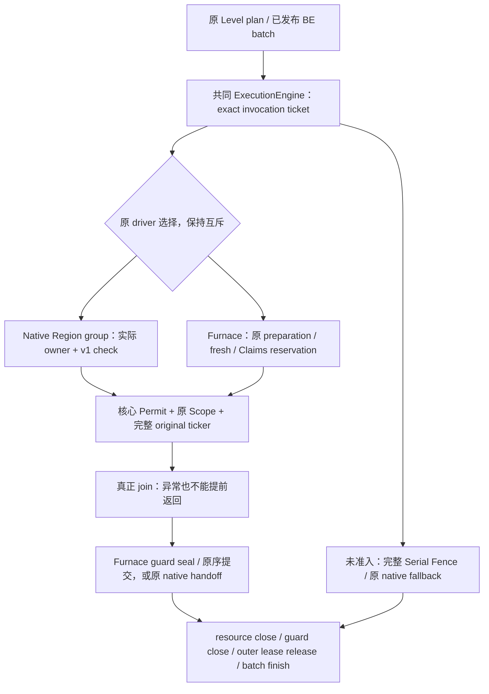
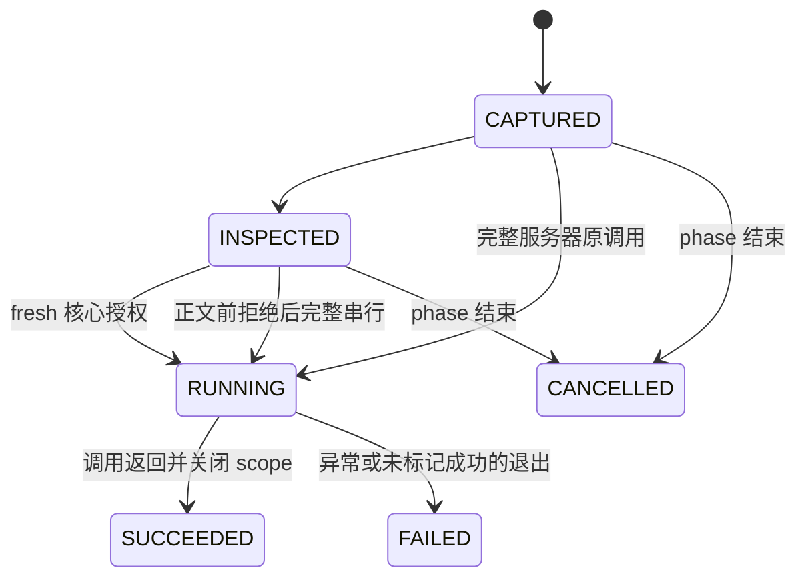

# 统一 Block Entity Execution Contract：第一片迁移与验证

基线：`4ea694316399b45ba60d07ade97b6d03babfde4f`。本轮已让原生 Region BE 路径、旧 `BlockEntityTickAdapter` 和受保护 Furnace Waves 使用同一个 invocation 授权内核与 batch 生命周期。两条调度器的排程、目标审计和提交实现暂时保留，避免一次重写整个执行系统。

Resource Ownership 的额外 MSPT/微基准优化继续冻结。配置默认值、BE 准入、Vanilla patch、Furnace preparation/recapture 和 Create 模块实现均未修改。本轮没有性能收益主张，没有新 Mod 类型获得并行准入。

[第一轮架构调查](MODDED-BLOCK-ENTITY-ADAPTATION-ARCHITECTURE.md)中的完整 generic coordinator、公开新 adapter 注册协议和多 home 组件是后续阶段；不能将本轮授权内核描述为这些功能已经实现。

## 1. 接口与兼容决定

实施前先保存了接口/迁移方案并建立测试。原方案正文及 SHA256 保存在本地验证证据中；以下描述最终落地行为。

[BlockEntityExecutionContract](../src/main/java/net/neoforged/neoforge/server/threading/api/BlockEntityExecutionContract.java) 是公开的只读模型，进入原有 compile-only API facade：

| 模型 | 当前字段/职责 | 不授予的能力 |
|---|---|---|
| `AdapterDescriptor` | adapter id、immutable exact type 集合、`REGION_OWNER` / `RESOURCE_SCOPED` | 构造描述不注册类型，不证明原实现/回调已安全，不授予 Lease |
| `Inspection` | descriptor、资源描述、`CANDIDATE` / `SERIAL_FENCE` | Candidate 仍需核心重审；没有 live BE/handler、Runnable 或 validator |
| `Refresh` | 当前 Inspection 引用与 fresh outcome | 相等的旧 Inspection 副本不能替代本 invocation 的原引用；Serial 不能被 refresh 扩成 Candidate |
| `InvocationTicket` | 内部 batch/phase、level、exact admission/wrapper/delegate/sequence、状态 | 私有构造，不进入 API jar，不交给 adapter |
| `Permit` | 内部 thread-bound、一次开始/完成/退出的调用权 | adapter 无法创建、跨线程使用、重复开始或控制提交 |

当前资源描述仅有 `UNPROVEN`、`REGION_LOCAL`、`FURNACE_LOCAL`、`FURNACE_CLAIMS`，明确对应已有执行路径。后两项是保留 Furnace 参考实现的内部桥接说明，不是公开的任意 Capability/Inventory 资源声明协议。将来新增完整资源贡献机制须单独进行能力协商与安全验证。

旧 `BlockEntityTickAdapter`、`ParallelApi` 和注册事件源码保持不变，API major 仍为 1，没有新增必实现方法，没有改变 lambda 或二进制回调签名：

- 旧 `prepare` 仍每个非空 native level phase 在静止服务器执行一次。
- 旧 `check` 仍在原 ticker 前、现有 Region Scope 内执行一次；没有擅自搬到服务器或执行两次。
- [ParallelAdapterRuntime](../src/main/java/net/neoforged/neoforge/server/threading/ParallelAdapterRuntime.java) 为注册项保存唯一 descriptor identity，fresh 检查/完成统计匹配该 identity，不能继承后来一个等值注册的身份。
- 类型声明、whole-chunk 回退、interior/border 规则和拒绝/完成计数仍由原实现决定。
- 新的公开 `inspect/refresh` adapter 注册入口尚未开放。当前模型由核心把已有审计结果转换而成，不能据此宣称未来 Mod 已接入。

## 2. 统一授权内核与执行桥

[BlockEntityExecutionBatch](../src/main/java/net/neoforged/neoforge/server/threading/region/BlockEntityExecutionBatch.java) 继承原 `RegionTickBatch`，每个 BE batch 建立一个 [BlockEntityExecutionEngine](../src/main/java/net/neoforged/neoforge/server/threading/region/BlockEntityExecutionEngine.java)。`RegionBlockEntityTickBatch` 和 `FurnaceWorkBatch` 都使用这个基类。

构造阶段按引用身份收集全部原 ticker，重复 wrapper 或 foreign level 在任何 body 前报错。调用跨 batch/phase、inspection 副本、已经开始的 ticket 都被拒绝。不调用 ticker 自定义 `equals/hashCode`。

[Engine 的 native 桥](../src/main/java/net/neoforged/neoforge/server/threading/region/RegionThreadingEngine.java#L6351) 在原 Region owner 和 ticker Scope 内生成候选、执行旧 adapter check，再调用共同内核签发 Permit。核心再次验证 exact binding、实际 authoritative Region 实例和注册描述；只有成功返回的完整原调用才计为旧 adapter worker completion。

[Furnace 桥](../src/main/java/net/neoforged/neoforge/server/threading/region/RegionThreadingEngine.java#L5764) 保留原先完整调用链：

1. 原 `FurnaceWorkPreparation`、whole-phase alias、Claims 与 directed plan。
2. canonical 外层 Region lease 获取与 mailbox delivery。
3. 原 fresh preparation / recapture、资源集合比较、全部 validator、whole-wave reservation。
4. 共同内核验证当前 ticket、Region guard 和实际 Resource Lease，再进入原 `FurnaceWorkScope` / Resource Scope，调用原 ticker。
5. 真正 join 后封闭 guard，再执行原 canonical `setChanged` 提交、关闭资源、反序释放外层 Region lease。

本轮未修改 `FurnaceWorkPreparation`、`FurnaceWorkScope`、`BlockEntityWorkPlanner`、dispatcher、原 commit 循环或 Vanilla hook。原 budget、普通 validator occurrence、distinct shared proof 和 fresh catalog 仍保留。

### Ticket 状态与失败

`SUCCEEDED` 描述调用 wrapper 正常结束，不替代实际原 body 的完成计数；原生 eligibility skip、Furnace `beforeBody` 和 worker completion 计数继续由原有 hook 判断。

已开始 ticket 无法回到 Serial，失败后不重放。未开始票据在 phase 结束被撤销，Map 清空，旧 ticket 或迟到任务无法在后续 Tick 继承权限。active batch 仍覆盖准备、worker、join、完整 fallback、提交与关闭，不重新取得会与 unload/shutdown 等待形成死锁的 lifecycle gate。

## 3. Region Owner 与 Resource Lease 的关系

[RegionState](../src/main/java/net/neoforged/neoforge/server/threading/region/RegionState.java#L473) 增加严格 owner/guard 检查：不能覆盖已有 owner，不能由另一线程释放 owner，不能在 owner 或 execution guard 尚活跃时清除 running lease。

| 状态 | 完整 Region owner | 同 Region 细粒度调用 | 释放外层 Region lease |
|---|---|---|---|
| Native Region guard | 一个持有实际 ownership 的 Worker，内部 ticker 顺序执行 | 拒绝 | guard 与 owner 结束后 |
| Furnace guard，允许开始 | Worker 无完整 owner；协调线程也不能开始提交 owner | 只允许已审计、一次性的 Furnace scope | 拒绝 |
| 实际 Resource Scope 活跃 | 所有完整 owner 均拒绝 | 对应 Permit 必须继续持有 | 拒绝提前关 Permit、guard 或 resource owner |
| join 后 `sealForCommit` | 仅协调线程可进入原提交短 owner scope；不能再创建 coarse guard | 所有迟到的新 Permit 均拒绝 | 提交、resource owner 和 guard 结束后 |

真实 Region 与资源 home 分开校验。Furnace Claims 的 home 是 phase 内的不透明身份，桥接使用该原 home，不把 `RegionState` 或坐标当成资源授权。Kernel 对实际 Lease 检查 domain/home、reserved 状态和外层边界；Permit 成功要求 Resource Scope 已消费并退出，不能只凭一个资源描述通过。

mailbox 保持在挂载 fine guard 前、原协调线程 owner 短作用域中交付。fine guard 挂载后，闲置且尚无 active body 并不等于已 join；必须显式 seal 才开放提交 owner。所有这些检查都是排他与生命周期检查，不新增世界读写权限。

## 4. Serial、安全降级及现有边界

- 未知 BE、未知 callback、未知资源和已有准入拒绝仍完整串行，不通过 namespace、扫描或访问历史放行。
- Furnace planner 的未知操作仍是 canonical Serial Fence；前一 wave 的通知提交完成后才执行 fence，之后重新 fresh 审计。
- 共同内核的 `beginSerial` 要求 phase coordinator 且没有 active invocation 或 reserved Region guard，防止未知原 tick 与 Worker 重叠。
- 旧 native 路径保留 whole-chunk 与批后 fallback 顺序。它没有在本片变成全局 canonical wave scheduler，不能保证任意 `A -> unknown -> B` 跨 chunk 顺序等价。这是尚未实施的调度迁移，不是已通过的能力。
- 原 executor rejection 的服务器 inline 路径使用独立 `beginInline`，要求实际 coarse owner。它可能与其他 Region 的 Worker 同时存在，不被冒充为静止全局 fence，也没有扩大原有准入。
- 原 native 与 Furnace driver 仍互斥。Furnace preparation 和共同内核都拒绝把 `ADAPTER_GUARDED` 当作细粒度 Worker 资格；不会跳过 v1 check 后借道 Furnace 执行。
- Worker 失败、managed wait 抛异常或 interrupt 时，原 physical join 仍必须完成。Furnace guard 在 join 后 seal，资源 Scope、Permit、guard、Region lease 分层关闭。取消未开始任务不能撤销已产生的效果，更没有通用 rollback。

Inventory、Capability、通知、跨 Region 网络和多 home 事务没有扩准入。Lease/Scope 不是 JVM sandbox；直接反射写、任意外部异步写和所有 ASM/coremod 变换没有被自动认证。

## 5. 测试结果与证据边界

JDK `21.0.13+9`，Gradle offline、单 worker、无 parallel/configuration cache，测试构建参数沿用 `21.1.250.60-beta`。全部检查串行执行。以下是最终通过结果，failure/error/skip 均为 0；不同配置会重复执行部分案例，不将它们相加当作独立新测试数量。

| 验证 | 结果 | 主要范围 |
|---|---:|---|
| 完整 core，默认 Resource OFF | **1244** | 原 core 1230 + 本轮 14 个新增案例；真实原 BE tick、其他 slices、生命周期与操作 API |
| fixed executor + Resource ON 定向 | **181** | kernel、adapter、Furnace、原生 BE、资源、lease 与 boundary；其中测试原有 flag OFF 覆盖仍有效 |
| persistent + Resource ON 定向 | **199** | 上述授权/状态测试及 planner/work graph；adapter fixture 实际使用 persistent pool |
| 实际未知 Furnace Mixin | **1** | 真实 transformed 原类被未知 hook 修改后，原 body 完整串行 |
| 独立 Create 6.0.10 transformed 集成 | **16** | 原模块、原 jar、原接口与新核心配合 |
| 实际未知 Create Mixin | **1** | 原独立 adapter 的未知变换拒绝路径 |
| 格式与 license | **通过** | Java 格式检查限定本轮修改的文件，license 使用既有检查入口 |
| compile-only API facade | **通过** | 40 个 class，其中 7 个为新增只读模型；不含 region 实现、InvocationTicket 或 Permit |

Create 原 jar SHA256 为 `ef87fe5709f1ba1f5b8bb20a2925b5afb4669e178fd6d8bf10c167759eefe37a`。Create 模块源码和构建脚本未改，核心没有新增 Create 类型判断。

新增 14 项由 [kernel 测试](../tests/src/junit/java/net/neoforged/neoforge/unittest/BlockEntityExecutionEngineTest.java)、[adapter 测试](../tests/src/junit/java/net/neoforged/neoforge/unittest/BlockEntityTickAdapterTest.java) 和 [Furnace 测试](../tests/src/junit/java/net/neoforged/neoforge/unittest/FurnaceWorkWavesTest.java)承担，包括：

- 描述不可变且不携带 Runnable/Lease/Permit；重复 ticker、重复开始、foreign phase、Inspection 副本拒绝。
- 同坐标不同 Region 实例不得继承权限；未知 candidacy 不能被手造描述扩大。
- Permit 跨线程调用拒绝；失败无法完整串行重放；phase retirement 撤销未开始票据。
- coarse/fine 冲突、空闲 guard 不等于 join、真实 Resource Scope 阻止提前释放、seal 后迟到调用拒绝。
- 两个已审计 adapter 在不同 Region 的原 body 实际重叠，检查/执行/完成各一次，并观察共同内核的 `REGION_OWNER`。
- 注册为 generic adapter 的 Furnace 在 Waves 模式中完整串行，同时另外两台受支持机器正常执行细粒度 wave；generic check/completion 为 0，不存在绕过审计后 Worker 执行。
- 真正 Furnace Worker 观察 `RESOURCE_SCOPED`，尝试取得完整 Region owner 被拒绝，原 litTime 与 worker completion 仍正确。

沿用并实际重跑的回归还覆盖真实加工产物/库存与通知提交、unknown fence 前后可见状态、reload/同位置 replacement、同引用空 stack 变非空、别名/预算拒绝、原 ticker 部分效果后异常不重放、executor rejection、managed wait 失败、unload 等待 Resource Scope 和提交、shutdown 等待与禁止 Worker 自等待。

测试先行的模型缺失编译失败、初始 fixture 构造参数错误和新增共存 fixture 缺少 server 的失败均保留为探索证据，不计为最终通过；修复后以上最终队列完成。不是用编译通过代替正确性测试。

本轮未运行新的实际安装服动态/连接 Hopper 管线/长时 soak、GameTest、完整 modpack、饱和吞吐或 MSPT 矩阵；历史 `.60` 服务器结果不能当作本轮新二进制结果。没有强杀运行中线程、无限期泄漏或任意未知 Mod 线程安全的证明。

## 6. 实际改动范围与后续迁移

生产 Java 共 10 个文件：新增只读 contract、共同 execution batch、共同 execution engine 三个文件；修改 runtime descriptor 桥、两个 BE batch、RegionState ownership、Engine 调用桥、Resource Lease 内部状态检查和 Furnace resource-home 可见性七个文件。测试共 3 个文件，其中 kernel 测试为新增。README/STATUS 增加当前阶段入口；上一轮架构报告保留。

没有修改配置默认值、Vanilla patch、Furnace preparation/scope、planner/dispatcher、Create 模块或准入白名单。冻结 `.60` installer/universal 的 SHA256 保持原值；本轮没有生成新安装器、发布、部署、提交或推送。

尚未合并的部分是原调度器与提交队列，不是一个隐藏的通用 callback Worker 接口。下一片应在此内核上建立有界 canonical coordinator 与新的 adapter inspect/refresh 注册协议，再逐一验证与 Furnace 的混合排程。第一批新增 Mod 仍只采用不同 Region 的完整原 ticker；Inventory/Capability 资源解析、同 Region 新细粒度目标、多 home 组件和 compute/apply 都另立审计与验证门槛。

主要兼容风险仍包括：内部构造器与 ownership 重入现在会更早拒绝错误调用；旧 native 全局顺序未重写；新内核的 ticket/guard/Permit 会增加未测量的管理成本。已有公开 v1 接口和 Create 回归通过不等于所有使用内部 API 或任意外部写入的模组兼容。
