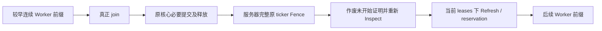

# Canonical Block Entity Coordinator：源码映射、接口设计与测试方案

本轮基线为 `2339050429dbec819f685b6c903091eab5ea1220`（`Unify block entity execution authorization and lifecycle`）。**本阶段完成源码调查与设计交付，不实施生产修改或新准入。** 下文的新 Coordinator、协议、测试名称与迁移阶段均是方案，不是已存在或已通过验证的功能。

上一片 [Execution Contract](BLOCK-ENTITY-EXECUTION-CONTRACT.md) 已统一调用授权，但 Native 与 Furnace 仍各自选择顺序、分组、回退及提交。本方案在现有 Ticket、Permit、RegionGuard 上增加一个服务器线程 Coordinator，先统一输入顺序和 Fence，再逐片接入原执行桥。Resource Ownership 的 MSPT／微基准优化继续冻结；Create 保持独立模块。

## 最新实施状态：C3-A2 最小 Native 子集已接入

[C3-A2 生产实现与验证](CANONICAL-BLOCK-ENTITY-C3A2-MINIMUM-NATIVE-ADMISSION.md)通过核心原函数、exact source／runtime、实际chunk/binding和fresh分支检查，让冷却>1或disabled的真实Hopper在不同Region Worker并行（overlap=2），活跃未知Capability路径完整串行。四配置实际回归：完整core1297项1293pass／4项后续目标failure，原1244项全通过。原C1预期不改，脚本Native输入换成真实原函数及准入后的观察钩子。下一阶段为C3-B效果归属／提交，再进入C3-C统一cursor；C4尚未进入。下文历史阻塞不表示本轮继续以文档替代生产实现。

## C3-A inventory 历史检查点：当时证明门槛阻塞

C0 源码映射与下文方案是 `233905042` 时的历史设计。后续 [C1](CANONICAL-BLOCK-ENTITY-C1-TESTS.md) 建立真实红测，[C2 实施记录](CANONICAL-BLOCK-ENTITY-C2-COLLECTION.md)在 `f6b48e24` 基线上接入实际 Level membership：pending merge／fresh onLoad 后锁内复制引用，锁外取 getter 与审计；同 phase ordinal 不再来自 chunk creation／explicit 两个数值域。Native canonical fallback 按 ordinal 合并，后项动态 eligibility 不再被起点永久剔除。

C2 修复 C1 的 5 项 collection／顺序红测；Native 越过 Unknown、v1 拒绝后越过 B、Native mixed input 的 3 项调度断言仍失败且保持启用。尚无统一 phase-level Coordinator；旧 Native／Furnace drivers 与 indexed／explicit helpers 均保留，原准入／默认配置不变。C2 实际测试矩阵、patch generation／apply 和边界见其记录，不能把下文的协议草案写成已实现。

本轮连续任务采用 **C2 Canonical Collection → C3 Native Coordinator/Fence → C4 Furnace 接入**，覆盖第 8 节原设计表中 C3/C4 的先后。阶段必须逐片达到自己的门槛，Native effect bridge 无法证明安全时停止后续阶段；不会为了完成 C4 将任意 level-end tasks 提前 drain、复用 Fence 前的 v1 prepared 成功或关闭既有功能。

[C3 实际阻塞记录](CANONICAL-BLOCK-ENTITY-C3-NATIVE-BLOCKERS.md)通过真实 Native body、原 level-end queue 与 Unknown Fence 重现效果不可见；当时4项目标失败。后续 [C3-A 生产效果 inventory](CANONICAL-BLOCK-ENTITY-C3A-NATIVE-EFFECT-INVENTORY.md)进一步追踪16类效果及原始 Hopper／Capability 生产链：未知 provider 在 Worker 上执行，不同 Region 可同时进入同一 handler，现有 declaration／descriptor／v1 check 缺少 body 前 callback/root 闭包证明。新增6项实际探针5pass/1failure，当前完整core1291项1286pass/5target failure，原1244项再次全部通过，C2五项修复保持。原C1八项仍有三项未转绿。

按最新 C3-A→C3-B→C3-C 阶段门槛，停在 C3-A，后两阶段均未进入；C4／C5／Create 不在本轮范围。生产代码／准入／默认值／预算未变，没有启用不完整 Coordinator。具体调用点、真实phase-end时机、缺失合同和最小内部原函数／fresh分支证明方案见新报告；不能仅给 Runnable 加ordinal后就宣称解决。下文 reinspectUnstarted／统一batch／cursor等仍为未实现设计。

## 1. C0 基线源码路径及仍独立的职责

### 1.1 Level 入口、收集与序号来源

| 当前入口 | 已核实行为 | 对统一调度的影响 |
|---|---|---|
| [Level BE phase](../patches/net/minecraft/world/level/Level.java.patch#L274) | 服务器合并 pending、设置 ticking 标志、执行 fresh `onLoad()`，然后选择原串行循环或 Region plan；finally 发布新增 ticker、恢复标志及 profiler | Coordinator 不能把 `onLoad` 或 finally 搬到 Worker；当前 phase 中新加的 ticker 按原 pending 规则在下一 phase 参与 |
| [Level 的两类索引](../patches/net/minecraft/world/level/Level.java.patch#L153) | `addBlockEntityTicker` 写 level/pending list；foreign ticker 另存列表；chunk index 按 chunk 注册顺序遍历 | chunk 注册顺序不是 level 的全局 ticker 顺序；foreign 与 chunk 两条索引不能直接拼接 |
| [RegionBlockEntityTickPlan.collect / accept](../src/main/java/net/neoforged/neoforge/server/threading/region/RegionBlockEntityTickPlan.java#L91) | 先 accept foreign，再收集 tickable、entities-loaded 的 chunks；显式单 ticker 路径保留测试及 foreign 支持；最终调用 `engine.tickBlockEntities` | 当前 collect 可以在 phase 开头省略不 tickable 的 chunk。新 canonical 路径若允许 Fence 改变后续 eligibility，不能把这种开头省略当作永远不参与 |
| [Chunk admission cache](../src/main/java/net/neoforged/neoforge/server/threading/region/RegionBlockEntityTickChunkCache.java#L110) | 当前 chunk 的 wrapper 按创建序号排序；缓存 exact binding／类型 candidacy／interior，不缓存 adapter 审计成功 | 可继续用于收集模板，但不能作为本次调用的最终 Permit 或 Fence 后 fresh 结果 |
| [LevelChunk sequence](../patches/net/minecraft/world/level/chunk/LevelChunk.java.patch#L665) | chunk-owned wrapper 使用 level 的递增创建序号；rebind 不换 wrapper 序号；非 chunk wrapper 返回 `Long.MAX_VALUE` | 只覆盖 chunk-owned 创建流，不能证明任意 foreign 插入顺序 |
| [Admission.sequence](../src/main/java/net/neoforged/neoforge/server/threading/region/RegionBlockEntityTickAdmission.java#L26) | chunk cache 使用上述序号；uncached `accept` 使用本 plan 的 `explicitSequence++`，cached accept 可能仍携带 chunk 序号 | 两个数值域会碰撞；稳定排序的输入顺序也不足以恢复丢失的跨索引顺序 |

当前没有“所有 ticker 共用一个、来自真实 level list 的 phase ordinal”。该缺口与 Ticket 的 exactly-once 授权是两个问题；授权内核不会自动修复收集顺序。

### 1.2 Native 路径

[Engine.tickBlockEntities](../src/main/java/net/neoforged/neoforge/server/threading/region/RegionThreadingEngine.java#L5625) 在非 Furnace driver 下：

1. 调用 `ParallelAdapterRuntime.prepareBlockEntityTicks(level)`，原 v1 adapter 的 `prepare` 在 publication 前、静止服务器执行一次。
2. 创建 `RegionBlockEntityTickBatch`、原子 publish；closed level 不执行，shutdown publication 使用当前完整服务器调用策略。
3. [leaseBlockEntityTickGroups](../src/main/java/net/neoforged/neoforge/server/threading/region/RegionThreadingEngine.java#L6132) 按 authoritative Region 分组；whole-chunk candidacy、boundary 邻域检查、lease retry、pack 仍各自实现。未知类型会使该 chunk 的 Native ticker 整体回退。
4. [blockEntityTickGroup](../src/main/java/net/neoforged/neoforge/server/threading/region/RegionThreadingEngine.java#L6362) 在 Worker 开完整 owner，建立 RegionGuard、entity ownership、group RNG、operation group、scheduled-mutation TLS。组内按 sequence 合并各 chunk，逐 ticker 查 binding、预留 block-update budget、进入原 Scope，执行 v1 `check`、签发 Permit、调用完整原 ticker。
5. stale／budget／adapter 拒绝放入 `fallbackChunks` 或 `fallbackTickers`；该 Region 仍可能继续后续调用，其他 Region 也可能已经运行。组退出时关闭 guard／owner，并 `clearRunning()` 释放其 outer lease。
6. 真正 join 后，服务器依次处理 block updates → entity removals → BlockEntityOperations → fallback chunks／tickers → scheduled mutations → failure report／close／batch finish。`applyBlockEntityOperations` 有操作时还会先应用 pending scheduled mutations。

[orderBlockEntityGroup](../src/main/java/net/neoforged/neoforge/server/threading/region/RegionThreadingEngine.java#L6575) 只保证单 Region 内的 sequence 合并；[tickFallbackBlockEntities](../src/main/java/net/neoforged/neoforge/server/threading/region/RegionThreadingEngine.java#L6613) 先遍历 fallback chunks，再遍历 fallback tickers，两类集合来自并发回报。**它们不是全 level 的 canonical Serial Fence 队列。** 不能将当前 `A → 未知 U → B` 的 Native 执行描述为已经证明 A、U、B 的全局顺序。

### 1.3 Furnace Waves 路径

[同一入口的 Furnace 分支](../src/main/java/net/neoforged/neoforge/server/threading/region/RegionThreadingEngine.java#L5630) 在 `furnaceWorkWavesEnabled && fixed layout` 时提前返回，跳过旧 native adapter prepare。它的独立流程为：

1. [tickFurnaceWorkWaves](../src/main/java/net/neoforged/neoforge/server/threading/region/RegionThreadingEngine.java#L5770) 建立／publish `FurnaceWorkBatch`，flatten admissions 并按 sequence 排序；超过 2048 units 则完整串行。
2. 原 `FurnaceWorkPreparation` 逐项审计 exact runtime、source／ticker／实际 chunk、lit 分支、slot／components、recipe／ingredient／OR children／mutable result、通知闭包；未知项为 exclusive Fence。`ADAPTER_GUARDED` 明确拒绝，不可绕过 v1 审计借道 Furnace。
3. Resource OFF 使用原 footprint planner；Resource ON 使用 `FurnaceResourcePreparation`、whole-phase alias／home 审计、Claims planner。两者均为 canonical directed dependencies。
4. 单项 wave／拒绝项直接完整串行；多项 wave 由 [executeFurnaceWave](../src/main/java/net/neoforged/neoforge/server/threading/region/RegionThreadingEngine.java#L5885) canonical 获取 outer Regions，交付 mailbox，建立 subordinate guard，再构建新的 preparation、重查整个 phase 的库存 alias，fresh／recapture／权限集比较／whole-wave reservation。
5. [submitFurnaceWave](../src/main/java/net/neoforged/neoforge/server/threading/region/RegionThreadingEngine.java#L5975) 使用 fixed lanes 或 persistent 的 bounded runners／未开始 tail stealing；正文通过共享 Ticket／Permit 与原 `FurnaceWorkScope` 执行。managed wait 抛异常也必须 physical join。
6. join 后 seal guard，[commitFurnaceWave](../src/main/java/net/neoforged/neoforge/server/threading/region/RegionThreadingEngine.java#L6020) 依 results 顺序、确认 source／chunk 仍有效后执行原 `setChanged`；随后关闭资源 owner、guard，反序释放 outer leases。异常不重放正文。

该路径已经保护 explicit Fence 和每 wave fresh 审计；仍有三处不能直接推广为通用 Coordinator：输入序号仍有 §1.1 的来源问题；整 phase 的依赖 plan 可能将非连续独立项放入较早 wave；初始拒绝与 fresh 拒绝的处理属于 Furnace 专用 driver，不能自动覆盖 Native／未来 adapter 的 late refusal。

### 1.4 共享了什么，尚未共享什么

[BlockEntityExecutionEngine](../src/main/java/net/neoforged/neoforge/server/threading/region/BlockEntityExecutionEngine.java#L32) 已负责 exact ticket identity、thread-bound one-shot Permit、实际 Region identity、coarse/fine guard、开始后不重放、未开始票据 retirement。**它不收集、不排序、不调度、不提交效果。** 当前 `inspect` 只允许 `CAPTURED → INSPECTED` 一次，`Refresh` 只有原 Inspection 引用及 outcome，不携带新的审计输入或资源集。

| 仍独立的部分 | Native | Furnace | Coordinator 的迁移责任 |
|---|---|---|---|
| 候选及顺序 | chunks → Region groups，组内 sequence | flatten 全 phase、sequence sort | 唯一 phase 输入与 cursor；不重复创建 Ticket |
| 规划 | chunk admission、Region packs、批后 fallback | directed waves、exclusive fence、Claims | 连续可执行前缀、明确 Fence、保守的 mode／resource 冲突 |
| outer lease 生命周期 | Worker 组退出即释放 | coordinator 持有至 join／通知后 | 新路径由 coordinator 持有至本 wave 的必要提交结束 |
| Worker 环境 | owner／entity Scope／RNG／operations／effect queues | fine Scope／可选 Resource Lease | 复用受保护执行桥，不能只抽一个 `ticker.tick()` |
| 效果 | 多种 batch queues、level-end tasks | changed 记录、原序 `setChanged` | 先证明哪些桥可在 Fence 前完成；未知效果不进 Worker |
| 降级 | 稍后批后补跑 | 当前 wave 完整串行 | 不让任何后缀 body 越过已知或 fresh 发现的 Fence |

## 2. Canonical sequence 的具体定义

建议 canonical 顺序为：**同一个 ServerLevel 的一次 BE phase，完成现有 pending merge 与 fresh `onLoad()` 后，level 实际 ticker list 的顺序。** 这是全 Chunk、全 Region 的顺序；不同 level／dimension 不合并成一个执行事务。

第一版新路径直接由 Level 的核心桥，在 ticker lock 下复制当前 list 的引用，释放锁后再收集／审计，每个条目分配 phase-local `ordinal = 0..n-1`。锁下不调用 mod getter、`isRemoved`、adapter 或任意用户 `equals/hashCode`。这个 shallow 引用快照只在核心 phase 内短暂存在，不是供 Worker 任意访问世界的 immutable snapshot。

- 直接记录原 list 是有意选择的正确性基线，会增加服务器逐 ticker 收集成本。此轮不追求保留“完全不遍历 ticker”的优化；以后若恢复索引合并，必须用同一个 oracle 证明 foreign／chunk／pending 的顺序。
- 不排序位置、chunk key、Region coordinate、adapter id、identity hash 或到达线程。lease acquisition 的 canonical Region 顺序是另一个排序，只防死锁，不定义 BE 原顺序。
- 缓存 admission 可以提供 exact binding 模板；新 phase admission 的 sequence 使用 ordinal，不能原地改缓存对象。wrapper 创建序号可留作诊断，不再做混合流的 canonical key。
- Ticket 仍只绑定一个原 wrapper／一次 phase；同引用重复出现沿用当前 kernel 在任何 body 前拒绝的策略，不用 silent dedup 隐藏重复执行来源。
- removed 条目及合法 eligibility skip 仍有其顺序位置，服务器检查后跳过；不授予 Worker。保持本 phase 的原 `runsNormally` 取值语义，对后续位置／chunk 的 eligibility 按串行 oracle 在可观察边界重新确认。不能在 phase 起点永久丢掉可能被 Fence 激活的后续 chunk；chunk eligibility 的临时复用最多到下一个状态变化边界。
- wrapper 在 Fence 后 rebind，原 binding 无权执行新 delegate。当前 wrapper 若按原语义仍应调用，可在它的原 ordinal 完整服务器调用一次；新增 wrapper 仍遵守 pending 规则到下一 phase。不能给同位置 replacement 旧 Permit。
- 新收集桥可能需要修改 Vanilla 的 Level patch；实施时以 patch 为权威，并执行 `:neoforge:genPatches`／`:neoforge:applyPatches`。本阶段没有改 patch 或生成源码。

“canonical”约束的是依赖、Fence、效果和冲突的先后。已证明互不影响的同 wave body 可重叠，OS 不保证较小 ordinal 先开始或先结束。测试不能把并行 body 的日志到达时间强制当作全序；Fence 及可观察提交必须满足明确的 happens-before。

## 3. Coordinator 的最小职责与内部接口

建议增加一个内部 `CanonicalBlockEntityCoordinator`，由 `RegionThreadingEngine` 在 phase 开头选用。它接收核心收集的有序 admissions、一个 `BlockEntityExecutionBatch`、原 barrier 及本 phase 固定的开关。它不成为公开 mod scheduler，也不引入一套与 Ticket 重复的生命周期状态。

| 数据／动作 | 唯一所有者 | 复用或最小新增 |
|---|---|---|
| canonical admissions、当前未开始前缀、暂存审计数据 | coordinator | admission.sequence 即 ordinal；一个 cursor／短期 plan |
| binding、Inspection、调用状态 | 现有 InvocationTicket／kernel | 复用 `CAPTURED / INSPECTED / RUNNING / SUCCEEDED / FAILED / CANCELLED`，不再建一个 status map |
| Permit／Guard／Resource Lease | 核心 kernel／原资源层 | adapter 得不到引用、工厂、mint token 或 close 权 |
| 目标审计及 immutable 候选输入 | 受审计桥／独立 adapter | 有界只读 inspect／refresh；不持有提交 Runnable |
| 真实 outer leases、dispatch、physical join、必要提交、释放 | coordinator 调用核心桥 | 保留既有 executor／dispatcher，不再造线程池或第二个调度图 |

示意控制接口如下，仅表达调用关系，并非本轮新增 Java API：

```java
// 内部；没有 adapter 可调用的 execute/commit(Runnable)。
CanonicalBlockEntityCoordinator.run(orderedAdmissions, batch, barrier, phasePolicy);

// run 内部：每次仅处理当前连续前缀。
inspectUnstartedPrefix();
planContiguousPrefix();
acquireOuterRegionsAndDeliverMailboxes();
refreshAllBeforeAnyBody();
reserveWholeWave();
invokeCapturedOriginalTickersWithCorePermits();
joinPhysicallyEvenOnFailure();
commitUsingProtectedCoreBridge();
releaseScopesGuardsAndRegions();
```

一个 BE phase 只能 publish 一个 active batch、构造一套 Ticket。不能在 Coordinator 里分别运行一个完整 Native batch 和一个 Furnace batch，再靠外层 list 称作“统一”。旧 driver 在新路径之外保留；新路径所需的 typed native queues 将从现有 batch 中逐项复用／迁移，不能嵌套另一个拥有 Ticket 的 batch。

旧 Native 的 `blockEntityTickGroup` 在 finally 会 `clearRunning()`，因此不能原封不动当新 Coordinator 的 wave callback。迁移时要让新桥的 Worker 只关闭自己线程的 owner／Scope／Guard，outer lease 由 coordinator 在必要提交之后释放；旧 driver 的原 finally 在等价测试通过前保留。Furnace 的 preparation、Claims 和通知函数不需要为统一而重写。

## 4. 统一 Inspect / Refresh 协议

### 4.1 内部语义

`inspect` 在没有 Worker 的服务器边界形成有界候选；`refresh` 在本 wave 全部 outer leases 到手、mailbox 已交付之后，重新形成当前审计输入、资源描述及允许的核心效果种类。它不是一个“版本没变”的 boolean，也不是 `new Refresh(oldInspection, CANDIDATE)` 就完成证明。

核心把返回事实与原 Inspection 引用、当前 exact wrapper／delegate／source／chunk／type／Region identity／registration identity 绑定，再决定是否 reservation。拒绝发生在任何正文前；callback 抛异常是失败，不吞成 Serial 后再完整重试。读 field／manager identity／topology revision 只是部分证据，不能替代完整的当前闭包审计。

建议为 kernel 增加一个严格内部的 `reinspectUnstarted`：只由当前 coordinator 在所有 Worker／Guard／Resource Scope 返回后，对 `CAPTURED` 或尚未开始的 `INSPECTED` ticket 替换当前 Inspection 与短期证明。旧 Inspection 引用立即失效，旧 Refresh／排队 start 均不得使用。RUNNING 及所有终态不能重新 inspect；Serial 拒绝在当前 phase 中保持保守，不通过 refresh 扩成 Candidate。**不创建替代 Ticket，也不修改原 admission 让 replacement 继承权限。**

在 Fence、完整串行 fallback、mailbox、已提交效果或会修改候选输入的前一 wave 之后，丢弃所有受影响未开始项的成功证明。首版不尝试推断任意回调的最小 invalidation 集合，重新 inspect 当前后缀；保留原 immutable 描述／容量可以，保留成功 validator／Catalog／网络稳定结果不可以。原全 phase alias／home 检查仍观察完整本 phase 引用集合，不能只查当前 wave 的候选。

### 4.2 未来独立 adapter 的入口草案

建议使用可协商的新能力注册，与现有 v1 并存；不修改旧接口的抽象方法或现有 record 的构造签名：

```java
// 草案：只读审计协议；S 必须经过深层不可变审计。
interface CanonicalBlockEntityAdapter<S> {
    AdapterDescriptor descriptor();
    AuditResult<S> inspect(InspectionContext context);
    AuditResult<S> refresh(RefreshContext<S> context);
}
```

`AuditResult` 是 `Serial(reason)` 或带新 immutable input／资源请求描述的 Candidate；核心创建对应 `Inspection/Refresh` 并绑定 Ticket。不能由 adapter 返回 Permit、Lease、Runnable、`execute`、`commit` 或一个用户提供的 `BooleanSupplier` 作为强制通过验证的入口。第一版 generic 只描述 `REGION_OWNER` 下完整原 ticker；`RESOURCE_SCOPED` 仍仅使用已有 Furnace 专用桥，不开放 Inventory／Capability、多 home 或自定义异步提交。

Context 只在同步服务器回调期间有效。若审计必须读目标实例字段，可给受审计 adapter 一个借用的 exact target 观察入口，其 read-only／不得保留约束属于可信 adapter 合同；返回值、Worker 输入及诊断不得携带 live BE／handler／chunk。核心不提供任意世界遍历、force-load、能力试调用或后台任务 API。Java 无法阻止借用对象经 `getLevel()` 越权或隐瞒 backing root，不能把这一协议写成 sandbox；完整调用闭包和所有参与 writer 仍需目标模块审核。

冻结注册、最多 128 adapters、重复 type／id 拒绝、server-only 否决和 server-session 清理沿用。建议新注册入口与 v1 共用 id／type 唯一性检查；同一类型重复声明 v1 与新协议时在注册阶段拒绝。目标模块根据 capability 选择一个入口，不能运行两套 ticker，也不能按偶然的注册顺序选一个。正式 API 的最小字段及 capability id 在对应实施片确定，本阶段不扩公开 facade。

### 4.3 v1 兼容与 Create

[BlockEntityTickAdapter](../src/main/java/net/neoforged/neoforge/server/threading/api/BlockEntityTickAdapter.java#L36) 承诺 `prepare` 每非空 native phase 一次，`check` 在 owner Worker／原 Scope 内、正文前一次。以下做法均不成立：把 `check` 搬到服务器、在 Worker 跨网络遍历、Fence 后偷偷重复 `prepare`、把 phase 起点的 prepare 视为 Fence 后成功证明。

建议首个新 Coordinator 路径对尚无新协议／完整 fresh 桥的 v1 entry 使用完整 Serial Fence，旧 driver 继续保持旧回调协议。这样可能减少 Worker 数，必须记录，不能称为性能等价。未来只有显式兼容桥及测试证明它能在本协议中提供 fresh 数据，才恢复该类型在新路径的 Worker 执行。不能用原 `check` 包一层布尔 Refresh 就假装完成迁移。

[CreateTickAdmission](../adapters/create/src/main/java/net/neoforged/forgia/compat/create/CreateTickAdmission.java#L58) 的 `Prepared(dimension, gameTime, stableNetworks)` 是具体例子：Fence 可在同一个 gameTime 内改变其他成员、网络或 backing inventory，旧集合不因此仍有效。Create 暂留旧独立模块／旧路径，新 Coordinator 下无新 fresh 协议则完整串行；以后由该模块提供新协议和整网重审。核心只识别通用注册 entry，不 import Create、不检查其 mod id／类型名，也不为它绕过 canonical Fence。

## 5. 连续前缀、Worker Wave 与 Serial Fence

### 5.1 为什么不能直接执行整 phase 的旧 waves

[BlockEntityWorkPlanner](../src/main/java/net/neoforged/neoforge/server/threading/region/BlockEntityWorkPlanner.java#L91) 按 canonical 方向处理依赖，但合法地把非连续独立节点放在同一 wave。例如 `A(write X), B(write X,Y), C(write Z)` 可得到 `[A,C] → [B]`。若 B 直到 refresh 才发现未知 callback，需要完整 Serial Fence，C 已经越过 B，单纯重新排序 fallback 无法补救。

新 Coordinator 首版只提交 **从当前 cursor 开始、没有未解决空洞的连续前缀**。可复用原 planner 判断候选资源冲突，但不把越过首个冲突／拒绝／不支持桥的后续项提前放入 wave；不需要再实现一套完整 graph builder。上例先 `[A]`，重新审计后再决定 B／C，而 `A(X), B(X,Y), C(Y)` 保持 `[A] → [B] → [C]`。

- 同一个 Region 首版 coarse wave 最多一个原调用，不能把一长串机器装进一个 task，让后半段才发现拒绝而其他 Region 的后续机器已经执行。
- 同 wave 的所有项先完成 fresh 审计／效果预算／whole-wave reservation，之后才允许第一个 body 开始；任务内不得再出现“拒绝并补到 phase 尾部”的控制流。
- 任一项在此时拒绝，释放尚未使用的 reservation／guard／leases，按原序完整服务器执行该待提交连续前缀。首版不在失败路径额外缩 wave；每个完整串行调用后作废后缀证明。
- wave launch 后若核心 final Permit 检查出现不应发生的 binding／proof 失效，不允许将一个隐含新 Fence 留到后面补跑。先停止未开始 work、join／清理并报告失败，已开始调用不重放；合法 removed／eligibility skip 必须有专门语义和状态记录。不能靠晚发现拒绝掩盖审计闭包遗漏。
- 没有原 Resource Lease 的 coarse 描述不是共享可变全局状态的安全证明。不同 Region 仍可能共享 backing root／全局表；不能仅凭坐标不同就并行。

### 5.2 Fence 的顺序与可见性



Fence 开始时，本 phase 的 active Permit／Guard／Resource Scope 必须为零，较早可观察效果已经按受保护桥提交。还须检查正常服务器调度协议下没有其他 batch／global Region Worker 与未知回调并行；当前 kernel 的 `beginSerial` 只查自身 phase，不能独立认证 server-wide quiescence。沿用并测试参与式 quiescent boundary，不从 active callback 重入 save／unload 等待。

未知 BE、未注册／歧义／失效 adapter、审计失败、proof／budget 拒绝、尚无安全效果桥的操作都调用完整原 ticker。Fence 本身包含同步原回调，不拆库存、消耗、完成、通知或即时返回。Fence 抛异常后按照原错误报告／移除策略清理，不能把它当作一次无效果的探测重试。Fence 不代表 JVM 任意异步 writer 停止；外部未参与协议的写不能被认证。

### 5.3 保守的混合 mode 与资源规则

现有 coarse guard 要求 Worker 真正持 Region owner；fine guard 要求 coordinator 下属执行，禁止 Worker 获取整个 Region。二者共用同一个 `RegionState.blockEntityExecution`，不能同时挂在同一实例上。多个机器不能各取得同一 Region 的完整执行权。

首个合并 driver 允许 Native／Furnace／generic／未知在同一个 canonical 输入流中交替，但先在不同核心提交桥处切开 wave，复用各自已证明的 Scope 和提交。混合输入测试必须通过；这不等于立即支持 Native+Furnace 同 wave 重叠。

以后若开放不同 Region 的 coarse/fine 同 wave，可用仅供排程的 Region token：coarse 对实际 Region identity 为 WRITE，fine 为 READ；同 Region 仍冲突。该 token 不加入 Claims 来伪造 home 或授予世界权限，真正 Claims reservation／Guard 检查仍执行。没有跨桥的完整 shared-root／效果审计，则继续切开 wave。多 home 组件不在本方案第一版范围。

Resource ON/OFF、whole-phase home/global alias、全部普通 Binding validator occurrence（含重复）、distinct shared proof、one-shot Lease、thread-bound Scope 继续由原层负责。2048 units／phase、512 resources／unit、131072 logical uses／phase 不因分 wave 重置或放宽；oversized phase 完整串行，后续动态溢出只处理尚未开始后缀，不能重跑已完成前缀。

## 6. 提交、清理和原行为保护

### 6.1 不能省略的 Native 效果桥

[Native batch](../src/main/java/net/neoforged/neoforge/server/threading/region/RegionBlockEntityTickBatch.java#L51) 不只有原 ticker：entity removals、BlockEntityOperations、scheduled mutations、block updates 和 group RNG 都影响可见状态。[RegionDeferredBlockUpdates](../src/main/java/net/neoforged/neoforge/server/threading/region/RegionDeferredBlockUpdates.java#L53) 当前是实际入队顺序，既没有 ordinal，也没有 per-invocation effect index；部分 worker server tasks 还在 level-end 才运行。不能把这些队列一次性提前 drain，就声称原序通知和即时返回已等价。

首版只让具有已证明效果桥的现有目标使用新 Worker 路径，其余完整串行；审计必须在正文前决定，不能正文中看到未知 callback 才切换。后续若迁移已有 typed records，核心按 `(ordinal, original-effect-index)` 保留原调用内顺序，再逐类证明队列的先后要求。不得排序任意用户 Runnable 或新增 adapter commit callback。原本要求即时执行／返回值／取消的 effects 不能擅自延期；它们保持完整串行。

`BlockEntityOperations` 可以调用完整服务器操作并影响后缀，必要时作为新的静止边界触发重新 inspect；不承诺任意 N 方或跨维度事务。原本 level-end 的合法任务不能一概提前执行，为其生产 body 建立新 canonical 桥前不准入新 Worker。

同 Region 被多个 wave 分开时不能重建同 seed 的 RNG 从头重放。若需保留旧 Region RNG，维护一个本 phase 的 Region 流并严格顺序消费；外部共享 RNG／未知 draw 顺序仍串行。旧 Region RNG 本来不等于 Vanilla 全局 RNG，不能因 canonical 排序就宣称数值等价。第一批 fixture 采用无共享 RNG 的路径，另外建立 RNG 专项对照。

### 6.2 生命周期与错误释放顺序

| 阶段 | 必须维持的顺序／断言 |
|---|---|
| publication | 复用 `publishTickBatch` 的原子 closed/shutdown 检查；read gate 在 lease acquisition 前释放；不为后续 inspect 再取得会与 cleanup 等待死锁的 lifecycle gate |
| inspect／Fence 间隙 | active batch 持续存在，不在每个 wave 间 `finish` 再重新 publish；否则 unload 会退休后缀引用 |
| fine wave | outer leases → mailbox owner 短作用域 → subordinate guards → fresh／all-or-nothing reservation → Permit／Resource Scope／完整 ticker → physical return/join → seal → 原 canonical 通知 → resource owner close → guard close → outer release |
| coarse wave | coordinator 持 outer leases；Worker 获取实际 owner／guard／原 Scope → 完整 ticker → Scope／Permit／guard／owner 返回 → physical join → 已证明的核心效果提交 → coordinator 释放 outer lease |
| managed wait 失败／interrupt | 先关闭必要 handoff 使 Worker 可退出，再 physical join；保留 interrupt／原异常，不能超时后释放仍在正文中的权限 |
| executor rejection | 原任务可能在提交服务器 inline；不重放、不计 native completion。必须经过同一已审计的 wave 边界；inline 与真正全局 Fence 仍是不同概念 |
| body／commit 已有部分效果后抛异常 | 执行必要 join、原错误／移除政策及 finally；不回退完整 tick、不清空记录以隐藏前半效果；不执行未被该政策允许的后缀 |
| cancel／retirement | 阻止尚未开始的票据与迟到任务；RUNNING 只能等待它实际返回，不 forcibly unlock。错误关闭 active Scope／Permit／Guard 仍拒绝；终态不可重新 inspect |
| shutdown／unload | 保留现有 level-closed skip 与 shutdown snapshot 完整串行策略的区别；不把所有 shutdown 自动改成“取消并丢掉”。拒绝 Worker／当前 batch 自等待，cleanup 等整个 phase 及必要提交后再退休 identity／服务 |
| save | `beginLevelSave` 目前只记录／诊断 active batch，不是自动事务或等待保护。禁止把 Worker／commit 重入 save 当合法测试成功路径 |

[RegionTaskBatch](../src/main/java/net/neoforged/neoforge/server/threading/region/RegionTaskBatch.java#L167) 的 rejected-inline、packed groups 与错误后 barrier 清理，以及 [RegionTickBatch](../src/main/java/net/neoforged/neoforge/server/threading/region/RegionTickBatch.java#L480) 的 handoff／physical join 保留；Persistent 只偷未开始任务，不偷 Permit 或已开始正文。新 Coordinator 复用外部 waves 生命周期模式，不给每个 worker/callback 新建生命周期管理器。

## 7. 测试方案：先建立会失败的行为断言，再迁移

本节列的是**待实现／待执行测试**。本轮没有添加 JUnit 或把历史通过数记作新 Coordinator 结果。测试应驱动真实 Coordinator 控制流与原 ticker，不能仅比较一份照抄 planner 的伪实现。

### 7.1 独立 oracle 与观察方式

使用一个小规模串行 oracle：同一初始世界／完整 ticker list，按原 Level 规则逐个执行完整 ticker，记录每个 ordinal 后的库存、components、计数、配方、状态、必要通知与守恒。对并行候选只允许交换已证明独立的 body；比较 Fence 前后状态、可观察 commit trace、每个原 wrapper 调用次数及最终完整状态。

Fixture 事件记录至少包括 `inspect / refresh / refused / body-start / body-end / serial-start / commit / scope-return / lease-release`，全部关联核心 ordinal 和实际线程。使用 latches／可控 executor 指定交错，不用 `sleep` 猜测并发。两个真正 Worker body 的同时活跃可证明实际 overlap；计数／提交任务数／编译通过不能替代。

### 7.2 新测试分组与具体失败条件

建议新增 `CanonicalBlockEntitySequenceTest`、`CanonicalBlockEntityCoordinatorTest`，仅在需要真实桥时扩展现有 Furnace／adapter／生命周期 fixtures。下列名称为测试意图，尚无对应新增文件。

| 用例 | 输入／变化 | 必须断言的结果 |
|---|---|---|
| 跨 Chunk／Region 真实序号 | list 为 A(R2C2), B(R1C1), C(R2C3)，chunk 注册顺序故意不同 | ordinal 与 level list 一致；不能按 Region／chunk 排序 |
| foreign 插入与显式序号碰撞 | chunk A、foreign U、chunk B；cached 与 uncached accept 交错 | U 是 A 与 B 中间的完整 Fence；不能靠 explicitSequence 或 MAX_VALUE 排在首尾 |
| pending／onLoad | onLoad 添加 ticker；body 添加 ticker；onLoad 抛异常 | 与原 pending／finally 语义一致，每项合法 phase 只调用一次，失败 onLoad 不重试 |
| Native/Furnace/generic 混排 | N0, F0, G0, U, F1, N1；unknown/legacy generic 也覆盖 | U 开始前较早 work 与提交结束；U 期间后缀零正文；后缀重新审计；未注册项完整服务器调用 |
| 已知 generic 两 Region | 仅测试模块内显式注册／完整审计的简单原 ticker | exact check／原 body／completion 各一次；允许 wave 中实际 overlap；没有新生产 type 白名单 |
| directed transitive chain | A(X), B(X,Y), C(Y) | `[A] → [B] → [C]`，无 connected-component 错误合并或逆序 |
| 非连续 wave 的迟发现 Fence | A(X), B(X,Y), C(Z)，B fresh 拒绝 | C 在 B 完整 serial 返回前绝不开始；不能使用旧 `[A,C]` 提前执行 |
| wave all-before-body | 连续 A/B，第二个 refresh／budget／reservation 拒绝 | 所有正文计数先为 0，整待提交前缀 canonical fallback；没有部分 Worker 再重放 |
| Fence 修改 recipe／组件 | U reload manager 或原地改 mutable result／OR child | Fence 后新 Catalog／输入／Claims；旧 manager identity／旧 success 不可放行 |
| Fence 改 slot／backing root | wrapper 相同但换 inventory；同 ItemStack count0→1；不同 wrapper 同 root | fresh 授权与捕获时 empty mask 正确；省略 WRITE 不得继承；alias 前拒绝 |
| Fence 改资格 | U 改 later chunk tickability／load、source／same-position delegate／注册服务状态 | 与串行 oracle 的 skip／完整服务器调用一致；replacement 不继承旧 Permit；不丢刚变合法的后续 ticker |
| re-inspect 身份 | 旧 Refresh、等值 Inspection 副本、foreign phase、已开始 ticket | 全部拒绝；只替换未开始项当前证明，原 Ticket／ordinal 不变 |
| Native whole-chunk 与 flags | 未声明同 chunk；server-only；interior/boundary；waves/resources 开关组合 | 不因拆细 Candidate 扩大 Native 准入；Furnace 专用已支持语义单独保留；Resource OFF 不 mint Claims Lease |
| coarse/coarse、coarse/fine | 同一真实 Region、多台机器；同坐标 replacement Region；different homes | 同 Region owner 唯一且排斥 fine；实际 Region identity 校验；不同 Region 也不能忽略 shared root |
| 通知与 effect bridge | 三种炉的完成／熄火／serial callback 读取先前产物；Native typed handoff | 原通知次数／顺序、库存、进度、pending schedule 一致；未知 bridge 的 body 在正文前 serial |
| v1 二进制与 callback 时机 | 原 lambda／默认 prepare；Fence 改预审网络 | 旧路径 once prepare、owner Worker check 的合同不变；新路径不把旧 prepared 数据当 fresh；不运行两套接口 |
| body／inspect／refresh／commit 异常 | 部分效果后抛异常；check 抛原异常 | 捕获原失败、必要提交／join／清理；原 ticker 不重放、不计成功 completion；后缀按错误政策停止 |
| executor rejection／throw | fixed 全拒绝／部分拒绝、persistent runner 拒绝、pack 中失败 | 每个应执行 body 至多一次，拒绝不计 native，后续任务不会因 barrier permit 漏回而挂起 |
| cancel 与 late runner | 任务排队未开始、Permit 未开始、正文阻塞、commit 阻塞 | 未开始可撤销，RUNNING 物理返回前不能释放；seal 后迟到 Permit 拒绝 |
| wait／unload／stop | managed wait 抛异常／interrupt；各 lease／body／commit／Fence 边界请求关闭 | 等完整 phase；running Regions、active scopes／permits／tickets／queued ownership 为零；不自等待／不提前 retirement |
| phase budget 与清空 | 2048/2049、512/513、131072/131073、多个 wave 后 overflow | 不按 segment 重置预算；全部保留原调用；结束无历史身份／lease／ticket 残留 |
| RNG 与 eligibility oracle | 两个 wave 用同 Region RNG；frozen phase；Fence 改 shouldTick 条件 | 不重复 seed 首段；不得把 Region RNG 宣称 Vanilla 流；按明确参考语义比状态 |

### 7.3 保留并重跑的真实回归

现有 [FurnaceWorkWavesTest](../tests/src/junit/java/net/neoforged/neoforge/unittest/FurnaceWorkWavesTest.java#L892) 已有 explicit Fence／reload、完整加工 trace、同位置 replacement、同引用空 stack、通知、异常不重放、managed wait、unload／shutdown 等案例，作为受保护参考，不删除或用新的纯 planner 测试替换。

现有 [RegionBlockEntityTickChunkIterationTest](../tests/src/junit/java/net/neoforged/neoforge/unittest/RegionBlockEntityTickChunkIterationTest.java#L131) 的随机对照比较 `tracesByRegion`，能证明 Region 内 tick set／trace，**不能作为全 level canonical 顺序证明**；新测试必须记录 interleaved foreign 和跨 Region Fence。旧快照复用／每 chunk eligibility 计数测试继续用于旧路径；新路径以带边界的语义 oracle 验收，不能假装两个收集算法的调用次数也相同。

复跑 kernel、v1 adapter、Native BE、boundary、resource ownership／scratch、planner／work graph、operations、task batch／worker／lease、实际 unknown Furnace Mixin、独立 Create 16 项及其 unknown Mixin 负对照。新增路径必须同时有 Fixed Executor 与 Persistent Worker，Resource OFF/ON，并覆盖 Furnace Waves OFF/ON 的合法配置；测试 fixture 必须实际创建对应 worker pool，不能只传 property 而仍使用固定池。

先跑能定位本片语义的定向测试，再完整 core；格式／license／compile-only API facade 是另列检查。实际 server 安装、真实变换、动态 IO／Hopper 管线、有限长时验证在生产路线切换前另行安排；不把本轮 JUnit 设计、历史 installer 或编译成功当作那些结论。正确性通过后也不自动启动 MSPT 微优化。

## 8. 迁移顺序、候选文件及每片退出条件

| 阶段 | 实际或预计文件范围 | 可审核退出条件 |
|---|---|---|
| C0：本轮，完成 | 本文、README、STATUS；本地 task／baseline／validation 证据 | 源码映射、接口与顺序决策、兼容风险、测试矩阵交付；生产／patch／config／准入未改 |
| C1：顺序与 Fence 测试先行 | 上述新 sequence／coordinator 测试；必要的 fixture helper | 独立 serial oracle、跨 Region／foreign／late-refusal 的可重复红测；编译缺类的 red 只记录，不作为语义覆盖 |
| C2：仅收集与诊断 | Level patch、RegionBlockEntityTickPlan、内部 ordinal/coordinator 入口；相应 patch 生成 | 新 canonical 输入与实际 list 逐条一致；仍由旧 driver 执行一次，诊断模式不 mint Permit、不调 adapter 第二遍；不使用 footprint 自动准入 |
| C3：Furnace 受保护桥 | Coordinator、必要的 batch/kernel 内部 re-inspect、Engine Furnace driver 外层；原 preparation/resources/commit 函数保留 | 一个 batch／kernel、连续前缀／fresh Fence／join／通知顺序；所有原炉开关、拒绝、异常、取消回归通过，两种 worker 模式均实跑 |
| C4：Native 混合输入，保守执行 | Engine native invocation/lease-release 桥、必要的 typed effect transport／batch，v1兼容测试 | 有 fresh 及效果证明的旧目标才 Worker；其余完整 Fence；unknown／v1 混排顺序通过；不批后补跑、outer lease 不提前释放 |
| C5：新审计协议的受控入口 | ParallelApi 注册能力／runtime、新只读协议、test-only generic adapter，API 工件 | 原 v1 二进制保持；冻结／重复注册／server关闭测试通过；新 generic 先仅测试 fixture 的不同 Region 完整原 tick，无新生产准入 |
| C6：选择性 rollout，最后清理 | 路由／明确的 default-off 实验开关与文档；之后才迁移独立 Create | 正确性与实际安装验证通过再决定切换；旧路径仍保留到等价覆盖完整。不同桥同 wave 和 Create fresh 是单独验收项，不随开关自动开启 |

阶段可根据红测缩小，不一次重写所有 batch。C2 的诊断只观察无副作用的已收集元数据，不“影子运行”未知 provider、Capability、recipe 或 handler。C3/C4 运行选择在 phase 开始确定；不能执行一半后把整个 phase 丢回旧 driver。运行中降级只处理尚未开始的原顺序后缀。

新路径的 canonical Fence 相对于旧 Native 批后 fallback 是明确的顺序修正；无法同时保留旧的非全局顺序 trace，又声称实现新全局 Fence。验收分别证明旧路径行为不变、新路径符合完整串行 oracle；不能要求错误时序也“等价”，或暗中把新路径设为默认。当前没有新增开关或改变任何默认值。

## 9. 本阶段交付与尚未验证边界

实际源码交付仅三份文档：新增本报告，README 与 STATUS 添加设计阶段入口。冻结基线记录 2379 个 tracked Java／patch／Gradle／TOML 文件；本地 `tmp/be-canonical-coordinator/final-validation.json` 记录逐 hash、文档引用及范围核验。两个原未跟踪日志保留，临时证据不是源代码发布物。

本阶段没有新 Java、patch、API、配置、adapter、测试实现或新并行准入；没有构建、JUnit、GameTest、Create／安装服运行、性能测量、提交、推送或部署。上一片 core1244、fixed-resource181、persistent199、unknown Furnace1、Create16、unknown Create1 是已发布基线结果，不是新 Coordinator 已通过。

待验证的关键边界是：真实全 level membership 顺序、late refusal 前缀、Native typed effects 的 Fence 可见性、v1 prepare 后状态过期、混合 mode 的 shared-root／权限冲突、physical join 下的取消与生命周期。租约不是 JVM sandbox，未知异步写、多 home／跨维度、任意物流／能力提供者、所有 runtime transform 与生产长期稳定仍不在自动认证范围。设计交付后再按本计划选择首片实施，不自动启动全部生产迁移或 MSPT 优化。
