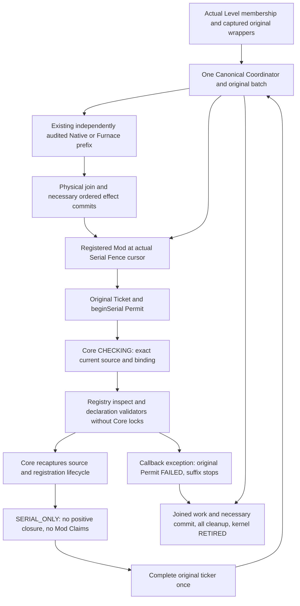

# C5.1–C5.5 — Core-controlled Mod execution proof readiness

Baseline: `9af01772d394e35cb67f7cd0882b234edd855ade`. This document records actual capabilities separately from the future positive Mod authorization backend. C5.1 is the source audit/design checkpoint; later sections will record subsequent implementation and actual validation. Unknown ticker closures remain complete Serial Fences.

## C5.1 audit and design

| Existing component | Actual authority and constraints | Reuse / missing condition |
|---|---|---|
| `ParallelAdapterRuntime` / `BlockEntityAdapterRegistry` | One server registration transaction, shared128 limit/id/type namespace, freeze and bounded tombstones. Dedicated audit outside registry monitor; revalidate after callback. SERVERS→registry close lock order. Coordinator-only mutation; asynchronous service close may mark entries CLOSED. | Keep the registration identity and volatile lifecycle state. External callbacks never run under registry/SERVERS/kernel/resource locks. Check callback reentry against freeze, shutdown and session retirement. |
| `BlockEntityAdapterPhase` | Attached after original canonical batch publication; only original serial Permit may inspect actual cursor. Exact subject comes from existing loaded chunk map and bound delegate; no BE load or Capability lookup. | Capture exact source/binding before callback and recheck afterwards. A declaration or CURRENT cannot establish actual identity/closure. |
| `CanonicalBlockEntityCoordinator` / `RegionThreadingEngine` | One monotonic cursor, one original batch/Ticket set, only continuous safe prefixes. Serial fence after physical join/required effects, then fresh suffix. Lifecycle waits use original admission boundary and reject self-waits. | Keep C5 callbacks at the actual cursor, complete original ticker once. Do not run unknown callbacks during lookahead to manufacture proof. |
| `BlockEntityExecutionEngine` | Exact admission/wrapper/level identity, inspection generation; CAPTURED→INSPECTED→RUNNING→SUCCEEDED/FAILED, unstarted→CANCELLED. Thread-bound one-shot Permit. RegionGuard distinguishes coarse owner/fine resource authority. | Store the Mod proof assessment on this original Ticket, not in a second authority/lifecycle registry. Denied assessment cannot be refreshed into worker permission. |
| Native / Furnace preparation | Core-specific exact ticker function/runtime/source/clock/attachments/binding/branch audit. Furnace also exact inventory/component/recipe/notification closure, whole-phase alias and fresh preparation. | These are existing complete trusted closure implementations. They do not certify any Mod body or arbitrary C5 registration. Leave original admission and real overlaps intact. |
| `BlockEntityResourceOwnership` | Real level/domain+root identity, home exclusion, READ/WRITE,512uses/unit,131072/phase,2048units; all validators, whole-wave all-or-none nonblocking reservation; one-shot Lease and thread Scope. Reject close while scopes active. | Only independently audited Core roots/validators may build Claims. Adapter resource/validator objects must never become Binding.current or held-region predicates. |
| `BlockEntityWorkPlanner` | Directed dependency order by reference identity, conflicting WRITE and full fences. | C5 declaration waves remain diagnostic. Core claims must cover all closure accesses and the entire ordered phase; a diagnostic plan omitting other invocations cannot drive execution. |
| Ticket-owned Effect Bridge | Physical join before extraction; ordinal/effect order, retire record before invoking payload, keep other necessary commits after failure; true level-end effects retain original boundary. | No new queue or generic effects API. Started body/commit failure never replays. Lease/outer exclusion must survive necessary commits. |

### Independent closure verification

Core cannot prove arbitrary JVM code from resource declarations, a class name, a Mod ID, Dedicated audit metadata, CURRENT validators, observed accesses, or a successful execution. A future positive backend must be an explicit Core-reviewed closed implementation: exact original ticker/delegate/source/runtime transformations, every reached callback/virtual dispatch/provider, RNG, recipe/config/topology, resource roots, all writers, notifications and commit semantics must be covered. Unknown Capability providers execute arbitrary callbacks even during a supposed read-only probe; never call them to discover a proof.

The implemented milestone will be a **Core refusal backend** bound to the original kernel Ticket, with independent binding and lifecycle checks before/after untrusted inspection. It will deliberately have no registration API for closure certifiers, no public proof constructor, no allow boolean, and no route from declarations to reservable Claims. General and Dedicated requests use the same gate. This is useful preparation and hardening, not a positive Mod Worker backend.

### Claims conversion and reservation contract

Conversion may occur only after a complete independently recognized closure yields a Core resource manifest. For each Adapter declaration Core must resolve the actual backing root without invoking unproved callbacks, compare root by `==` and actual level/domain, verify actual home/owner epoch, match permitted access (READ never upgrades to WRITE), establish immutable shared publication or exclusive local storage, and include every implicit access. Missing/extra/misowned roots, unknown or asynchronous writers, mutable wrappers, cross-dimension/multiple-home closures reject. Only Core predicates enter Claims; Adapter CURRENT is an additional refusal condition, never evidence.

Existing fresh Core preparation must recapture the entire proposed prefix after every serial callback/mailbox/commit; phase budget never resets. Existing planner plus all-before-body reservation checks every occurrence and whole-phase alias/home. Existing outer region exclusion prevents participating writers between validation and body, an immutable publication prevents shared read mutation, and real physical join plus required commit precede Lease/outer release. Version checks alone do not prevent a concurrent writer; unsupported dynamic/async resources remain serial. A midbody failure has no general rollback and never authorizes fallback/replay.

No conversion for arbitrary Mod requests is possible yet: there is no independently reviewed Mod closure implementation. **The C5.2/C5.3 refusal gate must mint zero Mod Claims, Reservations and Leases.** Existing Furnace still exercises the real reservation/lease path; its passing tests are labelled as existing authority tests, never Mod authorization.

### Planned proof lifecycle (no second authority)

Original Ticket remains the sole authority. An additional Core-only diagnostic assessment follows `UNCHECKED → CHECKING → SERIAL_ONLY` or `FAILED`, then `RETIRED` on original kernel close. Every check is within the actual original serial Permit, tied to exact admission and inspection generation; wrong phase/thread, duplicate checks and attempts after body/close throw. Pure refusal returns to the same complete original serial ticker; callback exceptions propagate and stop unstarted suffixes. The assessment retains no source/resource/validator/registry references. Future `VERIFIED/RESERVED` states are intentionally not implemented until a positive reviewed closure exists; existing Ticket/Permit/Lease states already define execution authority.

## Stage ledger

- C5.1: source audit and refusal-backend design complete; independent commit records this checkpoint.
- C5.2: original kernel Ticket now carries the Core-only assessment; exact active serial Permit required, duplicate/foreign checks rejected, pending/failed assessment cannot succeed, refused work cannot enter worker authority, kernel close retires it. No resource/validator/source retained in the assessment. Actual kernel plus existing real Level/registry regressions: **62/62**, exit0, no failure/error/skip (`c52-kernel`). This checkpoint does not yet attach the gate to C5 invocation inspection.
- C5.3: actual canonical bridge now starts assessment through the original engine, captures exact subject, runs the registry's inspection/validators with no Core lock held, recaptures the binding and checks the captured registration after callbacks, and completes a serial-only decision. Extra independently detected refusal causes are counted separately. Callback exceptions fail the original Permit; no request/subject is retained by the Ticket. **152/152** actual kernel/Canonical/General Adapter cases passed with Resource ON, including 6 new real-Level invocations and all original84 canonical cases; exit0/zero failure/error/skip (`c53-real-level`). General and Dedicated are handled identically; arbitrary backing-root/CURRENT requests never create Claims.
- C5.4: post-audit freeze safety window reproduced with **1/1 failing** production registry test before fix; the second short publication lock now also rejects frozen state. Adversarial actual Level/kernel/ownership/Furnace matrix with Persistent+Resource ON **247/247**, separate real reservation/Lease double-release test **1/1**, and real registered test-Mod GameTest **1/1 required**, all exit0. The filtered GameTest's229 unexecuted grouped entries are not passes. Every Mod body checks its real original Ticket is SERIAL_ONLY and has no Worker Guard/resource Scope. Full unfiltered suites remain C5.5 work. All reds and a failed ownership fixture (null Level causes Vanilla hasLevel skip; attack changed to another real Level retaining exactly-one assertion) remain preserved.
- C5.5: final integration review preserves public major1/protocol1 and all public binary descriptors; original internal void Session.inspect is also retained through an additive result method. Final **Core1400/1400**, three related configurations **419/419 each**, legacy Create16+unknown1, MSC25+unknown1, unknown Furnace1, and two complete unfiltered parallel GameTest suites **177/177 required each** passed, exit0/noCrash. Original1375/1328/1244 case multisets match actual XML; all84original canonical per configuration. Four framework NotProcessed per full suite remain unexecuted. Extra default-off real Mod control and two exact method-filtered2/2 runs pass; facade60class/pureAPI20class and actual baseline ABI comparison pass. Architecture freezes at conservative refusal, not positive Mod authorization. Final stage commit and local completion receipt record the delivered HEAD.

## Readiness boundaries

A first Dedicated Adapter may be developed as a serial request/audit integration now. A first **Worker-enabled** Dedicated Adapter additionally needs the narrow closure audit, trusted manifest conversion, prebody fresh proof, original kernel reservation bridge and adversarial real ticker tests described above. This task does not implement Create/Mekanism/AE2 type branches, a second scheduler/pool/Ticket/Permit/Lease/effect queue, general callback sandboxing, MSPT optimization or Bootstrap/Mixin refactoring.


## Final architecture and actual flow



The assessment has no public constructor or grant token. It is two enum fields on the original Ticket; no resource/source/validator/registration reference survives there. Exact active Permit plus coordinator, original phase/admission identity and original inspection generation determine the invocation. A copy of public Inspection/Request metadata cannot bind another invocation. `SERIAL_ONLY` cannot be promoted; a started Ticket is never refreshed or replayed. The existing Permit remains thread-bound and one-shot. Kernel retirement empties original Ticket/Guard sets and retires assessment fields on retained test observations.

This gate runs inside the existing **serial** Permit, before the ticker body. It deliberately cannot be switched into a positive Worker path by returning success: positive admission must be integrated while the original Ticket is still unstarted, at a real cursor fence with prior joins/commits complete and all untrusted preparation already finished, followed by independently fresh Core proof and original reservation. That future candidate integration and its Mod manifest converter are design-only; adding them requires a separate reviewed implementation. No released serial Permit can be recycled as a Worker Permit.

### Authorization and resource lifecycle

| Layer | Actual implementation now | Refusal, failure and retirement |
|---|---|---|
| Registration | Original server registry,128 bound, freeze, exact identity/tombstone; independent post-audit live/freeze/conflict checks | Coordinator-only invalidate/unregister. Server close marks CLOSED; current session keeps needed cleanup callback references until it closes. No callback under registry/SERVERS monitor. |
| Mod request assessment | Original Ticket UNCHECKED→CHECKING→SERIAL_ONLY; callback exception yields FAILED on Permit close | Wrong thread/phase/Permit or duplicate assessment throws. Invalid exact binding/lifecycle overrides weaker declaration diagnostics. CURRENT never proves body closure. Original kernel close→RETIRED. |
| Core execution Proof | Existing Native/Furnace Core-reviewed function/runtime/closed-branch proofs only | Every original fresh/admission condition remains. No new Mod closure verifier/positive proof issuer exists. |
| Mod Resource Claims conversion | Not implemented positively; gate refuses all arbitrary declarations before conversion | No Adapter predicate is installed as a Core Binding or reservation boundary. Never probe unknown providers for roots. Diagnostic waves confer no permission. |
| Existing Claims and reservation | Original Furnace preparation, reference identity/domain/home/READ-WRITE, whole-phase alias, cumulative budgets, original planner and all-or-none reservation | Refuse missing/foreign/stale/aliased resource or any validator failure before publication; original validators preserved. No partial grant escapes. |
| Existing Lease/Scope | Same one-shot subordinate resource Lease, actual outer exclusion, scope-thread checks | Cannot release while Scope active or enter after consumed/released; physical join/necessary commit precede outer release. Accepted running authority is not revoked early by service shutdown. |
| Effects/body | Existing original ticker, Ticket-owned invocation effects and actual level-end queues | Started failure is terminal for this invocation. Effects retire before commit payload; finish other started necessary commits, retain failures, do not start untouched suffix. No general rollback. |

Resource/version stability is proven only for supported closures whose complete writers participate in outer exclusion or immutable publication. A version returned CURRENT before a callback cannot protect against unknown asynchronous mutation. Unsupported shared handlers, mutable aliases, unknown provider callbacks, unknown runtime transforms, multiple homes or dimensions and uncooperative writers remain serial. The adversarial serial version-change test proves no replay; it does not prove that a hypothetical Worker could safely run during a version change.

## C5.4 adversarial coverage map

Each row is checked against actual final XML case names. Existing ownership/kernel cases call the production reservation/Lease implementation, not a second proof model; actual Level and GameTest cases cover the full canonical path. No test issues a Mod proof or grants a fake Adapter permission.

| Required scenario | Production evidence | Limit of conclusion |
|---|---|---|
| 1 Resource identity mismatch | `equalNamesAndArbitraryBackingRootsNeverBecomeCoreClaims`, `coreRecapturesActualSourceAfterAnAdversarialValidatorReturnsCurrent`; existing actual-domain/object identity tests | No arbitrary root is authenticated; no Mod Claims minted. |
| 2 Ownership change | `ownershipChangeInsideAnAdversarialInspectIsIndependentlyRejected`; existing inconsistent home/foreign domain/retirement tests | Exact source/Level rejected; generic multi-home conversion unsupported. |
| 3 CURRENT/INVALID/UNKNOWN | `adapterValidationAlwaysPassesTheOriginalKernelRefusalGate` plus existing General Adapter resource/dependency cases | CURRENT still SERIAL_ONLY; failed/unknown never authorize. |
| 4 Unregister during proof creation | `lifecycleLossDuringProofCreationPreservesExactlyOneCompleteSerialBody` UNREGISTER | Cleanup and original body once, no worker grant. |
| 5 Invalidate during execution | `lifecycleAndResourceVersionChangeAfterBodyEffectsNeverCauseSerialReplay` | Actual serial body's already produced effect survives; no retry/rollback. |
| 6 Phase close while resources live | `readReadScopesOverlapAndCoordinatorCannotReleaseRunningResources`, `levelUnloadWaitsForResourceScopesAndOrderedNotificationCommits`, original canonical blocked-commit/unload tests | Actual existing Furnace/resource path; there are no Mod Leases. |
| 7 Multiple Regions/shared root | `inconsistentRegionHomesRefuseEvenReadAliasesAndDoNotWaitForLocks`, `twoAdaptersWithOneSharedRootRemainCompleteOrderedFences` | Actual reservation refuses foreign homes; Mod declarations only diagnostic and serial. |
| 8 READ/WRITE | `conflictsAreRefusedAtomicallyBeforeAnyLeaseEscapes`, four real Level shared-root access combinations | Existing real reservation all-or-none, no declared Mod grant. |
| 9 Multiple Adapters/same root | `twoAdaptersWithOneSharedRootRemainCompleteOrderedFences`; existing directed A(X),B(X,Y),C(Y) test | One phase, ordered complete serial bodies, diagnostic waves never dispatch. |
| 10 Callback exceptions | `exceptionDuringInspectionOrValidationFailsTheOriginalProofAndSkipsUnstartedSuffix`, existing combined body/effect/cleanup failures | Original Ticket failed, suffix untouched; no swallowed failure or replay. |
| 11 Worker admission rejection | `fixedExecutorRejectionRunsEachCompleteTickerOnceOnTheServer`, `aLateRefusalPreventsEveryLaterBodyAcrossRegionsAndRefreshesTheSameTickets`, new original kernel rejection checks | Existing actual Fixed/Persistent execution paths; no positive Mod backend to reject after reservation. |
| 12 Resource version changes during execution | `lifecycleAndResourceVersionChangeAfterBodyEffectsNeverCauseSerialReplay`, existing fresh binding/recipe/stack change cases | Tests serial Mod effect/version/invalidation and existing supported fresh proofs, not arbitrary concurrent-writer safety. |
| 13 Repeated reservation/Lease release | `originalReservationScopeAndLeaseCannotBeReleasedTwiceOrReenteredAfterJoin`, `oneLeaseCannotExecuteOnTwoThreadsOrBeReplayedAfterJoin` | Actual original ownership API; no duplicated Lease implementation. |
| 14 Fallback duplication | New midbody effect/failure test; original partially effective General Adapter and Canonical body/commit failure cases | Started original body is terminal; refusal before body runs complete serial invocation once. |
| 15 External callback/Core locks | `callbackCanQueryAndCloseServiceOnAnotherThreadWithoutRegistryOrCoreLockDeadlock`, existing audit-monitor and close-during-audit tests | Bounded latch tests without sleeps; no JVM sandbox guarantee. |
| 16 Concurrent register/unregister/shutdown | Same concurrent real registry/API close test, lifecycle-loss variants, existing real unload/shutdown/prepare/callback-self-wait cases | Foreign registration/handle mutation rejects; server close cannot release running original kernel authority. |

The post-audit freeze regression was a real production registry bug: audit callback could freeze the registry before the second lock, which previously still published the entry. `c54-freeze-red` has1test/1failure/exit1; the fix adds only the missing post-callback frozen check. `c54-adversarial` also preserves an independent fixture failure: nulling Level triggers Vanilla hasLevel skip. The corrected attack assigns another actual Level and retains the original exactly-one body assertion. All raw XML, commands, logs and inputs remain in `tmp/be-core-proof/`; nothing is overwritten to turn a failed run green.

## Final validation

Machine receipts/commands/exits/input hashes/XML/logs: [readiness evidence](CORE-MOD-EXECUTION-PROOF-READINESS.json). Raw logs/worlds/jars stay local in `tmp/be-core-proof/`.

| Final run | Actual result | failure/error/skip | Gradle exit |
|---|---:|---|---:|
| `final-v1-fixed-on` | 419/419 | 0/0/0 | 0 |
| `final-v1-persistent-off` | 419/419 | 0/0/0 | 0 |
| `final-v1-persistent-on` | 419/419 | 0/0/0 | 0 |
| `final-v1-full-core-fixed-off` | 1400/1400 | 0/0/0 | 0 |
| `final-v1-unknown-furnace` | 1/1 | 0/0/0 | 0 |
| `final-v1-create` | 16/16 | 0/0/0 | 0 |
| `final-v1-unknown-create` | 1/1 | 0/0/0 | 0 |
| `final-v1-msc` | 25/25 | 0/0/0 | 0 |
| `final-v1-unknown-msc` | 1/1 | 0/0/0 | 0 |
| `full-game-persistent-on-v1` | 177/177required | 0failure/4NotProcessed | 0 |
| `full-game-fixed-off-v1` | 177/177required | 0failure/4NotProcessed | 0 |

Full1400=all1375C5baseline cases+25new (4kernel+6realLevel+14adversarial+1realreservation). Each three related configurations419/419, all84original canonical and all25new cases per configuration. The original1328C4.2 and original1244 case counters also match actual prior XML, with only Ingredient object-display identities normalized. Native/Furnace overlap2/2, original C5 one-phase overlap2/2 and original batch/Tickets are confirmed by XML markers. Original JUnit sources/assertions remain unchanged.

Each complete parallel GameTest suite uses a new isolated world and177registeredrequired tests. XML231grouped entries/179uniqueIDs/227passed entries/4NotProcessed remains explicit: testFeatureFlagPacks, extendPoiTypeTest, customBoatType, testAttachmentSyncManual. Their original empty optional labels are preserved. No exclusion/dumper/XML changes. Every actual Mod body now checks the original kernel Ticket SERIAL_ONLY, with no Worker Guard/resource Scope, and Native overlap2/samePhase40Mod bodies40shared callbacks still holds. All previous save-reload/POI/plant/Furnace controls execute.

`full-game-persistent-on-v1`: noCrash; retained ERROR/FATAL 63 lines, WARN 63 lines; categories {'test-mod-entity-missing-attributes': 4, 'fresh-test-directory-properties-file-absent': 1, 'legacy-test-mod-local-tag-fallback-mismatch': 1, 'intentional-unregistered-permission-node': 57}.

`full-game-fixed-off-v1`: noCrash; retained ERROR/FATAL 63 lines, WARN 63 lines; categories {'test-mod-entity-missing-attributes': 4, 'fresh-test-directory-properties-file-absent': 1, 'legacy-test-mod-local-tag-fallback-mismatch': 1, 'intentional-unregistered-permission-node': 57}.

These legacy test entity/permission/tag/properties diagnostics are not suppressed or called zero-error logs. Manual/client coverage, arbitrary Modpacks and installed long soak are not established. The filtered C5.4 game1required test is additional evidence and never substitutes for the two full suites.

Gradle默认参数化XML显示名省略method名；先前汇总器的按method名查找报错已记录为analysis-parser-attempt1.json，不改变任何raw XML/log或测试结果。为消除同一class中两组boolean显示名的歧义，最终源额外按完整method过滤各执行2/2：callback failure与midbody no-replay，命令/退出码/XML仍单独保留；其它参数组按实际class+唯一参数标签映射。未把汇总脚本失败当成测试失败或成功。

Facade60classes byte-match current compiled output; C5package20classes compile with only JDK21+annotations, no Minecraft/region/runtime/registry dependency. Public API major1/protocol1 and descriptors/methods unchanged. The old internal void Session.inspect signature is also retained through an additive internal inspectRequest result method. Final formatting/license/facade build passes; no test count attributed to that build.

Independent phase commits:

- `13f973bad2b1adf437a9f811feb70b1ff5f2e692`: C5.1.
- `f591778faa460adfcc2703e3ef7141a2133bdc67`: c52.
- `b74d6461d6743b4090a2b5c55d060b8b334b45bf`: c53.
- `0867b5ae80f15d8fdc23a7a63f63029ee7cccac8`: c54.

All final raw evidence is frozen to identical source hashes before/after every run. Final Java changes were not made after successful tests. No positive Mod authorization, no Mod Claims converter, no concrete Dedicated Adapter, no new installed-server binary/longsoak and no MSPT result is implied.

Exact final commands:

`final-v1-fixed-on`:

```sh
export JAVA_HOME=/home/yc/.local/opt/jdk-21.0.13+9
export PATH="$JAVA_HOME/bin:$PATH"
./gradlew --offline --no-configuration-cache --no-parallel --console=plain --max-workers=1 -PforgiaVersion=21.1.250.60-beta -PfurnaceResourceOwnership=true :tests:junitTest --tests '*CoreMod*Test' --tests '*CanonicalBlockEntity*Test' --tests '*GeneralBlockEntityAdapter*Test' --tests '*BlockEntityTickAdapterTest' --tests '*FurnaceWorkWavesTest' --tests '*BlockEntityResource*Test' --tests '*BlockEntityExecutionEngineTest' --tests '*RegionBlockEntityTick*Test' --tests '*RegionTaskBatchTest' --tests '*RegionPoi*Test' --tests '*RegionEntityTickPolicyTest' --tests '*CustomFeatureFlagsTest' --tests '*ParallelApiTest'
```

`final-v1-persistent-off`:

```sh
export JAVA_HOME=/home/yc/.local/opt/jdk-21.0.13+9
export PATH="$JAVA_HOME/bin:$PATH"
./gradlew --offline --no-configuration-cache --no-parallel --console=plain --max-workers=1 -PforgiaVersion=21.1.250.60-beta -PfurnacePersistentWorkers=true :tests:junitTest --tests '*CoreMod*Test' --tests '*CanonicalBlockEntity*Test' --tests '*GeneralBlockEntityAdapter*Test' --tests '*BlockEntityTickAdapterTest' --tests '*FurnaceWorkWavesTest' --tests '*BlockEntityResource*Test' --tests '*BlockEntityExecutionEngineTest' --tests '*RegionBlockEntityTick*Test' --tests '*RegionTaskBatchTest' --tests '*RegionPoi*Test' --tests '*RegionEntityTickPolicyTest' --tests '*CustomFeatureFlagsTest' --tests '*ParallelApiTest'
```

`final-v1-persistent-on`:

```sh
export JAVA_HOME=/home/yc/.local/opt/jdk-21.0.13+9
export PATH="$JAVA_HOME/bin:$PATH"
./gradlew --offline --no-configuration-cache --no-parallel --console=plain --max-workers=1 -PforgiaVersion=21.1.250.60-beta -PfurnacePersistentWorkers=true -PfurnaceResourceOwnership=true :tests:junitTest --tests '*CoreMod*Test' --tests '*CanonicalBlockEntity*Test' --tests '*GeneralBlockEntityAdapter*Test' --tests '*BlockEntityTickAdapterTest' --tests '*FurnaceWorkWavesTest' --tests '*BlockEntityResource*Test' --tests '*BlockEntityExecutionEngineTest' --tests '*RegionBlockEntityTick*Test' --tests '*RegionTaskBatchTest' --tests '*RegionPoi*Test' --tests '*RegionEntityTickPolicyTest' --tests '*CustomFeatureFlagsTest' --tests '*ParallelApiTest'
```

`final-v1-full-core-fixed-off`:

```sh
export JAVA_HOME=/home/yc/.local/opt/jdk-21.0.13+9
export PATH="$JAVA_HOME/bin:$PATH"
./gradlew --offline --no-configuration-cache --no-parallel --console=plain --max-workers=1 -PforgiaVersion=21.1.250.60-beta -I /home/yc/Minecraft/Forgia/tmp/be-core-proof/format-selected.gradle :licenseCheck :tests:licenseCheck :checkFormatting :tests:checkFormatting :tests:junitTest
```

`final-v1-unknown-furnace`:

```sh
export JAVA_HOME=/home/yc/.local/opt/jdk-21.0.13+9
export PATH="$JAVA_HOME/bin:$PATH"
./gradlew --offline --no-configuration-cache --no-parallel --console=plain --max-workers=1 -PforgiaVersion=21.1.250.60-beta -PfurnaceUnverifiedHookControl=true :tests:junitTest
```

`final-v1-create`:

```sh
export JAVA_HOME=/home/yc/.local/opt/jdk-21.0.13+9
export PATH="$JAVA_HOME/bin:$PATH"
./gradlew --offline --no-configuration-cache --no-parallel --console=plain --max-workers=1 -PforgiaVersion=21.1.250.60-beta '-PcreateJar=/home/yc/Minecraft/Forgia/tmp/create-adapter/final-server/mods/[机械动力] create-1.21.1-6.0.10.jar' :create-adapter:junitTest
```

`final-v1-unknown-create`:

```sh
export JAVA_HOME=/home/yc/.local/opt/jdk-21.0.13+9
export PATH="$JAVA_HOME/bin:$PATH"
./gradlew --offline --no-configuration-cache --no-parallel --console=plain --max-workers=1 -PforgiaVersion=21.1.250.60-beta '-PcreateJar=/home/yc/Minecraft/Forgia/tmp/create-adapter/final-server/mods/[机械动力] create-1.21.1-6.0.10.jar' -PcreateAdapterUnverifiedHookControl=true :create-adapter:junitTest
```

`final-v1-msc`:

```sh
export JAVA_HOME=/home/yc/.local/opt/jdk-21.0.13+9
export PATH="$JAVA_HOME/bin:$PATH"
./gradlew --offline --no-configuration-cache --no-parallel --console=plain --max-workers=1 -PforgiaVersion=21.1.250.60-beta -PmobSpawnControllerJar=/home/yc/Minecraft/Forgia/tmp/msc-v3/pack/mods/mobspawncontroller-neoforge-1.21.1-1.2.3.jar :mobspawncontroller-adapter:junitTest
```

`final-v1-unknown-msc`:

```sh
export JAVA_HOME=/home/yc/.local/opt/jdk-21.0.13+9
export PATH="$JAVA_HOME/bin:$PATH"
./gradlew --offline --no-configuration-cache --no-parallel --console=plain --max-workers=1 -PforgiaVersion=21.1.250.60-beta -PmobSpawnControllerJar=/home/yc/Minecraft/Forgia/tmp/msc-v3/pack/mods/mobspawncontroller-neoforge-1.21.1-1.2.3.jar -PmscUnverifiedHookControl=true :mobspawncontroller-adapter:junitTest
```

`full-game-persistent-on-v1`:

```sh
export JAVA_HOME=/home/yc/.local/opt/jdk-21.0.13+9
export PATH="$JAVA_HOME/bin:$PATH"
./gradlew --offline --no-configuration-cache --no-parallel --console=plain --max-workers=1 -PforgiaVersion=21.1.250.60-beta -I /home/yc/Minecraft/Forgia/tmp/be-core-proof/game-private.gradle -Pc5Run=full-game-persistent-on-v1 -Pc5Profile=canonicalGameTestServer :tests:runCanonicalGameTestServer
```

`full-game-fixed-off-v1`:

```sh
export JAVA_HOME=/home/yc/.local/opt/jdk-21.0.13+9
export PATH="$JAVA_HOME/bin:$PATH"
./gradlew --offline --no-configuration-cache --no-parallel --console=plain --max-workers=1 -PforgiaVersion=21.1.250.60-beta -I /home/yc/Minecraft/Forgia/tmp/be-core-proof/game-private.gradle -Pc5Run=full-game-fixed-off-v1 -Pc5Profile=canonicalGameTestServer -PcanonicalResources=false -PcanonicalPersistent=false :tests:runCanonicalGameTestServer
```


## Architecture readiness and next task

**Ready for a first serial Dedicated Adapter's registration/audit/resource description and lifecycle development. Not ready to grant a first Mod ticker Worker permission.** Both General and Dedicated use the same original registry, cursor, Core gate and execution authority. Dedicated audit strings are documentation, never proof. The Core contains no Create/Mekanism/AE2 imports, mod-id branches, positive backend registration mechanism or arbitrary Runnable/commit API.

A separate next task should select one very small exact original ticker branch, enumerate every virtual callback/effect and all actual writers, prove runtime/function/source identity and stable ownership/publication, and implement one Core-owned closure verifier plus trusted manifest-to-Claims conversion. Integrate any positive candidate before original Ticket RUNNING, reuse the original kernel/outer exclusion/planner/reservation/Lease and ordered commit, and verify refusal/physical-join/exactly-once with that real ticker. If closure or writer stability is incomplete, retain the complete Serial Fence.

Known limits: reflective/ASM or asynchronous protocol violations are not sandboxed; malicious inspect can mutate because it executes arbitrary JVM code, although it remains serial and cannot create worker authority. No generic rollback, shared Capability/provider safety, topology publication, dynamic multiple-home/cross-dimension transaction, arbitrary in-flight resource version protection, all-Modpack certification, player-loaded long soak, native-memory leak proof or MSPT benefit is established. Manual/client framework entries and legacy logging-only diagnostics remain separate from required GameTest results. This task stops after C5.5 and does not start any concrete Adapter or C6.
