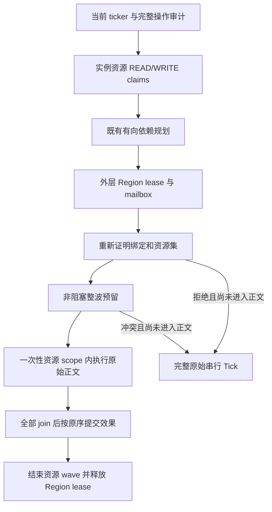

# General Block Entity Resource Ownership — 第一阶段与性能改进

版本：`21.1.250.58-beta`；基础协议交付于 `.57-beta`。通用资源身份、声明、非阻塞 lease 和线程 scope 已接入 Furnace Work Waves。
本次增加 fresh-pass 共享 READ、compact 执行规划和 lease 表复用，见 [第二阶段实现与前后测量](BLOCK-ENTITY-RESOURCE-OWNERSHIP-OPTIMIZATION.md)。
新增 `enableRegionThreadingBlockEntityResources`，默认 `false`，需重启。
它还要求既有 BE worker、furnace waves 和 fixed region layout；单独打开本项不会启动任何新机器或 worker 路径。

## 1. 审计与复用

| 既有协议 | 保留职责 | 本次集成 |
|---|---|---|
| Region Ownership | 粗粒度排他、生命周期、mailbox 与发布屏障 | 是所有细资源 lease 的外层前提；不能由资源声明跳过 |
| Block Entity Tick Admission | 精确 ticker/delegate、位置、类型、当前绑定 | 保留当前操作准入；原版证明仍要逐次检查 |
| Shadow Work Graph | 有界、不完整的历史观测 | 不输入权限签发，不用于推断完整 footprint |
| Directed Dependency Planner | canonical 顺序的 READ/WRITE 依赖、exclusive fence | 实例资源键；执行只计算等价的有向 depth，原图诊断单独保留，没有无向着色器 |
| Furnace Work Waves | 审计原始正文、异常不重放、join 后有序通知 | 首个内部资源协议使用者；旧 scope 的更窄限制仍保留 |
| Cross-region Operations | 不透明弱引用、静止主线程／批次完成阶段的完整操作 | 不改成 worker 多 owner 事务，不增加阻塞等待 |
| Work-Stealing Dispatcher | 一波独立任务的派发与未开始任务窃取 | 沿用现有 runner／lane，不新增线程池 |

**一份声明不是安全证明。** 通用层只验证声明的一致性、冲突、绑定及 lease 生命周期。
调用方仍必须审计完整正文、传递调用和效果闭包；任意模组返回一组 claim 不会自动变成可并行机器。

## 2. 资源身份与绑定

核心类型：`BlockEntityResourceOwnership`，位于内部 `server.threading.region` 包。

- `Identity(domain, instance)` 的两个分量都按 `==` 比较；实际 Level 实例是执行路径的 domain。
  不使用 dimension id、坐标、BE type、对象 `equals()` 或 `identityHashCode` 单值作为唯一身份。
  `identityHashCode` 仅用于哈希桶，最终仍比较两个真实引用。
- 同一库存／stack 对象无论经哪个位置或视图暴露，都得到同一个身份。
  视图或 capability wrapper 若不是同一对象，未来适配器仍必须解析至真正 backing resource；框架不会猜测它们是否别名。
- `Binding` 将身份与其 home region token、纯验证器、可选 BE lookup position 分离。
  同位置替换对象是新身份；同对象的 attachment、chunk 和 ticker 必须仍然成立。
- home region token 由当前 phase 的核心桥接对象生成，映射到已持有的精确 `RegionState`。
  一个 mutable identity 被声明在两个 home 中，整份相关证明拒绝。
- home 为 null 的资源仅允许显式 READ，表示当前操作已审计的共享读取发布物，例如配方目录。
  该声明不能通过 chunk hook 取得 world chunk 读取／写入权限；chunk 访问还必须持有本地 home 绑定。
  同一个对象既是共享读取发布物又是任何本地 WRITE 时拒绝，不能给全局对象伪造一个本地区域。
- identity、claims 和 lease 只在当前 phase／wave 内有效；没有跨 tick 缓存，也没有永久 registry 强引用世界。
  当前 phase 自身会强引用参与对象，直到已有批次 join／commit 收尾；这是生命周期保护，不是长期引用服务。

原有 `BlockEntityWorkPlanner.Resource(Level, Kind, long)` 保留给 shadow／旧 furnace 路径。
新的 `Resource(Level, Object)` 是不同的 INSTANCE 键形式，不与同坐标历史键相等。

### 防止替换与卸载继承权限

Furnace 证明重新检查：真实 Level、已加载的真实 chunk、chunk 当前映射、BE map 中的精确实例、
removal 状态、当前 ticker/delegate、实际库存对象，以及配方管理器和所有捕获的共享 stack。
唯一新增的 vanilla patch 是 `LevelChunk.furnaceWorkMatchesChunk`：递归拆开 rebind wrapper 后检查 bound ticker
实际属于哪个 chunk 实例。同位置 chunk reload 不能让仍绑定旧 chunk 的 ticker 获得新 chunk 的 lease。
已审计的等待阶段只服务 chunk-source 主线程队列；原版实际卸载在 `ChunkMap.processUnloads`
排空独立 unloadQueue 时发生，不会在这个 wait 中执行完整世界 tick。任意模组在其他线程或服务回调
直接改 attachment／目录／库存不属于支持协议；没有用跨 tick 历史或缓存去掩盖这种缺少失效证明的情况。

## 3. READ/WRITE claims 与有向计划

`Claims.Builder` 构造 immutable bounded 声明：

- READ/READ 共享；任何 WRITE 冲突由原始 canonical 顺序生成依赖。
- 重复身份统一，WRITE 覆盖 READ，但每个 attachment validator 都保留并验证。
- 每单元最多 **512 个 binding**，每 phase 最多 **131,072 个 binding**、**2,048 个单元**。
  duplicate validator 也占预算，避免“同资源无限验证器”绕过上限。
- domain 不一致、foreign home、写共享发布物、同位置绑定不同对象、空／不完整声明都不能签发 lease。
- 不认识的操作仍是完整 serial fence。历史 footprint、遗漏访问和资源溢出不是可裁剪的“额外并行容量”。

一般 identity 使用者可以声明共享可变对象，planner 会按读写排序，而不按 BE 类或位置把它们假定独立。
第一阶段 Furnace **仍保留既有全 phase 库存 alias 拒绝**；这比仅排序更保守，避免改变该已验证协议的可观测中间状态。
跨 home alias 以及共享配方结果 alias 也保守串行。

`.58` 的 `SharedReads` 只共享一次 fresh preparation 内的 immutable 身份表与其显式 publication proof。
它不共享成功验证结果，不跨 wave／tick 缓存，逻辑预算不因底层存一份而降低；普通 Binding 的不同／重复验证器仍全部保留。
通用 `Plan.dependencies()` 现在返回内部 `ExecutionPlan`（waves/maxWidth），诊断图仍用原 `BlockEntityWorkPlanner.plan`。

初始计划之后，前面的串行 fence／mailbox 可能修改世界。真正进入波次前，会在外层 region 排他内重新准备操作，
重新建立当前资源集并与原计划比较。资源 identity／访问模式／home 改变则整波在任何正文开始前转完整串行，
不能带着旧依赖进入 worker。内容变化虽可能不改变 identity，也仍经过原有动态燃烧、组件、配方、周边效果检查。

通用 planner API 对超预算输入抛出拒绝；Furnace 桥在到达 phase 上限时停止积累，
将该 phase 全部置为 serial fences，保留完整原 tick。不会对部分已执行正文做回退。

## 4. Resource lease 与 scope

### 签发

1. 已有批次先在生命周期 gate 内发布，保证 shutdown／level unload 等待它。
2. coordinator 按已有 canonical 顺序取得外层 Region exclusion，交付 mailbox。
3. 对整波重新进行 current-operation proof，并验证 planner 的资源集仍然成立。
4. `tryAcquireAll` 一次性检查整波：外层 home 仍被持有、所有绑定有效、READ/WRITE 兼容、无隐藏 home/global-write 冲突。
5. 只有所有请求都通过才发布一组 lease。冲突直接返回拒绝；没有 per-resource monitor、等待队列、超时自旋或 worker 锁获取。

这里的非阻塞是**新增细资源预留**的性质；没有改变已有 coordinator 等待外层 Region lease 的协议。
细资源 coordinator 的构造／签发、lease 的进入是包内核心入口。public claims／identity 类型用于描述和测试，
不构成可由模组调用的权限签发 API，且均属 `@ApiStatus.Internal` 实现边界。



### 执行与结束

- 每个 lease 只能进入一次：`RESERVED → ENTERED → CONSUMED → RELEASED`；未开始的 lease 也可在 phase 收尾直接释放。
- worker 或拒绝后 inline runner 进入 `Scope`，权限存于普通 ThreadLocal，不传播到 child thread。
- 不能嵌套、扩展或重入 scope；不能在另一线程使用／关闭；正文结束或失败都会消费 lease。
- `Scope.require(domain, object, access)` 要求精确对象和 Level，READ 不能升级 WRITE，且外层 region exclusion 必须仍有效。
- 未声明的 BE reference、chunk write、entity query/admission、scheduled mutation、block update 或直接 dirty marking 在现有 hook
  入口先拒绝，没有返回假 AIR/null 的修复逻辑。
- BE lookup 暴露可变 live 对象，因此该 lookup 权限要求 WRITE；纯 READ claim 不能据此取得任意可变 BE 引用。
- 只有 coordinator 能结束整波资源所有权；active scope 尚未退出时不能释放。shutdown 请求不会撤销已发布批次的在途权限；
  外层生命周期仍等待全部正文和有序 commit。

lease 不是 Java sandbox：原始字段、没有 hook 的调用、外部异步修改不会自动被拦截。因此**完整当前操作审计仍是必要条件**，
不能把测试中一个 scope 检查通过当作任意代码安全证明。

## 5. Furnace 首个迁移

开启新开关时，`FurnaceResourcePreparation` 将既有候选转换为：

| 资源 | 声明 |
|---|---|
| 精确 furnace 实例 | WRITE |
| 非空的三个当前库存 stack | WRITE |
| 当前加载 chunk | READ |
| 当前 RecipeManager | 共享 READ |
| 整个相关 cooking catalog 暴露的非空 ingredient/result stack | 共享 READ |

已经燃烧、原始 issued ticker、精确 vanilla 家族、runtime/method 审计、ordinary ingredients/items、无组件／附件、
周边通知 inert 等旧条件全部保留。方法审计还覆盖了 nest members，避免遗漏 ticker wrapper 等内部类。
资源模式拒绝未知 ServerLevel／ServerChunkCache／LevelChunk 子类；自定义 ingredient 在解析其 items 或 matching 回调前拒绝。

不把配方只视为一个 manager 身份，是因为 `getResultItem()` 暴露 mutable ItemStack：
库存可以与它别名，精确 vanilla BE 类型并不能证明这是本地对象。现在这类 alias 在正文前保守串行，
后续 worker 读取已经提交的 canonical 状态。OR ingredient 的合并 cache 可能去重对象，
但 matching 仍访问各 child 自己的 cache，因此所有已审计 child 的非空 stack 也纳入 READ 集合。

claims 描述正文触及的受保护共享资源，不枚举纯局部值。已审计 `result.copy()` 创建的未共享 stack
可以写入已持有 WRITE 的本机库存；这不提供 worker 临时申请其他世界资源的接口。

FurnaceWorkScope 继续负责原始正文 entry/success tail、精确 ticker/task 和窄通知协议；
新资源 scope 负责对象权限，existing Furnace scope 可以进一步收紧，但不能放宽资源 scope。
通知仍在**该波全部正文 join 后**按原始 results 顺序在服务器线程提交，资源 wave 随后关闭，再释放 Region lease。
异常按旧策略报告；已产生部分效果的 Tick 绝不自动重放。

开关关闭时不构造资源证明、不签发 lease；原有 serial／region 路径及旧 furnace 波次选择仍由旧开关控制。
共同的方法审计现在还检查 nest members，因此旧实验波次也会更保守地拒绝未知 wrapper Mixin。
新增 hook 的 inactive scope 检查不是免费的零成本；下述测量不能替代默认关闭路径的整服 A/B。

## 6. 诊断与性能开销

`/neoforge regionthreading workgraph` 在既有炉子正文与 shadow 报告之间新增独立资源行：

- `enabled`：请求开关；不表示未满足依赖时也会签发 lease。
- `phases/proofs`：当前资源方案的准备阶段数／通过初始证明的候选数。
- `waves/issuedLeases/refusedWaves`：成功预留波次／签发数／尝试预留后的拒绝数。
- `proofAndPlan`：初始资源 capture＋通用规划的累计耗时，不含原有实例／配方准备，也不含后续重验证。
- `reservation`：整波 `tryAcquireAll` 耗时，不含 outer Region leasing、后续 scope 检查、正文或 commit。
- `.58` 新增 `revalidation` 和 `completedPhases/fullPhase`，覆盖 fresh 证明与完整实验 BE 阶段；具体边界见 [计时说明](BLOCK-ENTITY-RESOURCE-OWNERSHIP-OPTIMIZATION.md#6-阶段计时的覆盖范围)。
  新共享表构造计入原有炉子 `prepare` 和 `fullPhase`，不在 `proofAndPlan` 中；不要跨版本单独比较后者推导收益。

这些计数不是完成正文数、加工件数或节省时间。实际完成继续看 `nativeCompleted/failed/skipped`。
重验证等未被子指标覆盖的成本仍存在；不能把少量子指标相加当完整 BE 阶段。

独立工具 [OwnershipCostProbe](../tools/block-entity-resource-probe/OwnershipCostProbe.java) 测量无世界、无 Mockito、
无 worker 派发的合成 capture／planner／reserve／scope／release 成本。输入事先构造，
每个单元拥有 source/input/output WRITE、共享 chunk READ 与可调共享 READ 资源。scope 每个单元执行五次 require。
这是单线程机制开销，**不是 Minecraft body 或整服 MSPT 测量**。
最终数据与具体复现参数见 [性能记录](BLOCK-ENTITY-RESOURCE-OWNERSHIP-PROFILE.json)。

下表保留 `.57` 首次探针的历史结果（没有 fresh revalidation），不代表 `.58` 当前成本。
`.58` [完整阶段配对数据](BLOCK-ENTITY-RESOURCE-OWNERSHIP-OPTIMIZATION-PROFILE.json)包含第二次 fresh capture 和资源集比较。

| 单元数 | 每单元 claims | 总开销 p50 ms | 分配 B/phase |
|---:|---:|---:|---:|
| 2 | 68 | 0.0397 | 87528 |
| 64 | 68 | 1.2457 | 2094808 |
| 256 | 68 | 5.7791 | 8463528 |
| 256 | 260 | 25.8738 | 31091944 |

每组 21 个样本；完整预热安排、组件定义与其他 8 组数据在 JSON／工具 README。
总开销直接计时，组件中位数独立计算，不能要求各自 p50 相加严格等于总 p50。

共享资源很多时，逐单元 map/set、重复身份、验证器与既有有向图诊断的分配显著。
当前交付优先保证闭包和生命周期正确，不把增加并发或签发更多 lease 宣称为性能提升。

## 7. 第一阶段 `.57` 历史验证方法与证据

以下为 `.57` 冻结源码验证，本地逐次证据在 `tmp/be-resources/`；`.58` 的测试、产物和安装服结果见 [第二阶段验证](BLOCK-ENTITY-RESOURCE-OWNERSHIP-OPTIMIZATION.md#7-正确性与交付验证)。

| 验证 | 结果 |
|---|---|
| 完整核心回归（默认关闭新资源模式） | **1203 项**通过，无失败／错误／跳过 |
| 新资源模式＋普通 executor 的定向回归 | **125 项**通过 |
| 新资源模式＋persistent work-stealing 的同组回归 | **125 项**通过 |
| 通用 identity／claims／scope／并发／生命周期测试 | 核心回归内 **20 项**；其中含 1000 个 seeded 顺序对照样本 |
| 现有 Create 集成 | **16 项**通过，未扩张其资源准入 |
| 单独 JVM 的实际未知 Mixin 控制 | **1 项**通过，资源模式＋persistent 开启，完整原始串行 tick 保留 |
| 全新私有目录默认 GameTest | **174 个必需测试**通过，正常保存退出 |
| 全部 root/tests 格式与许可证、diff 空白检查 | 通过 |
| Vanilla LevelChunk patch | 单独生成后单独重应用成功；patched source archive 核对精确 chunk 绑定 helper |
| 最终 universal jar | 包含生产资源类，不包含 unittest 或控制用 Mixin |

GameTest 启动时另有附带的非 GameTest `testFeatureGating` 框架状态失败：GameTestServer 用
`FeatureFlags.REGISTRY.allFlags()` 建世界，而该 ServerStartedEvent 检查要求部分 flag 关闭。
它不属于 174 个必需 GameTest，没有计为通过，也没有为了本次验证修改 feature flag 实现。

`.57-beta` 实际安装包私有服务器，无 helper mod，原版数据包，fixed layout、2 workers、persistent 开启：

| 资源模式开启，六台同 chunk 惰性周边炉子 | 结果 |
|---|---:|
| 正常推进 tick | 441 |
| 资源签发／成功原始 worker 正文 | 2640 / 2640 |
| 资源预留拒绝／正文失败／跳过／提交拒绝 | 0 / 0 / 0 / 0 |
| 同时处于原始正文内的最大数量 | 2 |
| 原生加工完成通知提交／输出铁锭 | 12 / 12 |
| 保存退出码 | 0 |

资源模式关闭的同版本、同 seed／布局／输入对照也完成 **441 tick、2640 个原始 worker 正文、
12 次加工通知、12 个铁锭、退出码 0**；其资源计数 `issuedLeases=0`，确认保留旧 Furnace 波次路径。
这是功能对照，不能从两次运行的累计计数器推导性能比值。

该 fixture 的初始资源 capture＋plan 累计 **259.36 ms / 441 phases**，
reservation 累计 **79.15 ms / 440 waves**。它们是部分机制计时，包含冷启动阶段，
不含后续完整 revalidation／alias 扫描、scope 检查等全部成本，不能相加当作完整 tick／BE 处理时间。
本次实炉用于正确性与收尾验证，**没有进行整服性能 A/B**。

最终 installer 为 `neoforge-21.1.250.57-beta-installer.jar`，11,011,560 bytes，
SHA-256：`ed31c58e4a1a2b7c22d315d744944336d853b9c38d084c8bd7c1c7420995ddce`。

```sh
# JDK 21；开新资源 scope，复跑原有炉子准入、拒绝、异常和生命周期场景
./gradlew --offline --no-configuration-cache --no-parallel --console=plain --max-workers=1 \
  -PforgiaVersion=21.1.250.57-beta -PfurnaceResourceOwnership=true \
  :tests:junitTest --tests '*FurnaceWorkWavesTest' --tests '*BlockEntityResourceOwnershipTest'

# 同组行为经 persistent work-stealing runners
# 上述命令另加 -PfurnacePersistentWorkers=true

# 安装包实炉，必须新私有目录和已接受 EULA；不部署／修改原世界
python3 tools/block-entity-workgraph-smoke.py \
  --resource-ownership --furnace-waves --inert-layout --furnace-count 6 --persistent-workers \
  --run-dir /absolute/path/to/new-private-directory \
  --libraries /absolute/path/to/installed-library-cache \
  --eula /absolute/path/to/already-accepted/eula.txt \
  --java /absolute/path/to/jdk-21/bin/java
```

并发与生命周期测试覆盖：读共享重叠、原子整波拒绝、重复 WRITE 合并并保留验证器、同一 lease 双线程竞争、
错误线程／二次关闭、异常后不可重入、外层排他丢失、生命周期拒绝、全批 alias／global-write 冲突、
单元和 phase 溢出、1000 个 seeded pairwise 有向依赖对照。Furnace 场景还覆盖精确旧 chunk 绑定、
BE 替换、卸载重载、真实 level unload 等待在途 scopes 和有序通知、串行 fence 配方替换、
可变 recipe-result 库存 alias，以及三种炉子的 20 tick vanilla 行为对照。

## 8. 下一阶段

1. **继续减少证明成本**：`.58` 已共享 fresh READ 表、取消执行路径图诊断和 lease 权限复制；局部对象／map、全批 alias 和重复动态目录审计仍存在。
   缓存只能用于有完整失效协议的事实，不能因 manager 身份或上 tick 未变而跳过可变 result/component 检查。
2. **拓扑／别名生命周期**：给 provider/backing inventory、double chest、capability invalidation 和 chunk 代次建立协议；
   存取真实 provider 可能执行代码，必须在静止准备阶段审计，不能 worker 临时 resolve 后补 claim。
3. **通知效果闭包**：READ chunk 与 WRITE BE 是不同资源，不自动形成包含关系。
   当前由炉子 inert 周边证明保证独立。新操作必须同时声明存储／通知资源，不能只把 coarse chunk key 删除来换并行度。
4. **有限 Vanilla Container／Hopper**：包括所有 slots/sides、源/目标、冷却与 tick 时间、stack 别名、item entity、
   capability 优先路径和 dirty／comparator 通知；先做 canonical trace／库存守恒对照。
5. **公开模组协议**：在有完整 provider generation、prepare/revalidate、effect commit 和 fail-closed 规范后再设计注册 API。
   当前 Create admission/API 工作保留，未自动迁移；未支持 capability／Create 任意机器的细资源 worker 权限。
6. **整服性能与长期正确性**：同 chunk／跨 chunk／已有多 Region 并行、混合未知机器、workers1/2/4/8、
   完整燃料周期、卸载重载、红石和容器互联 A/B；持续记录完整 tick p50/p95/p99、分配／GC、正文与拒绝。
   未证明收益之前保持默认关闭。
