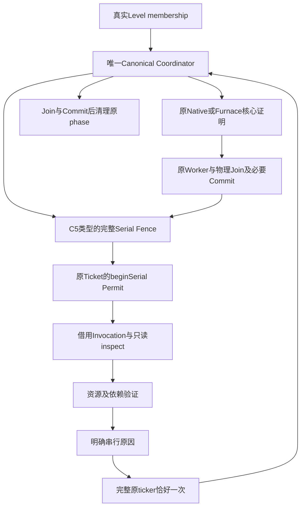

# C5 — General Mod Adapter Architecture

当前C5.1–C5.5的[Core证明拒绝后端与就绪报告](CORE-MOD-EXECUTION-PROOF-READINESS.md)在原kernel Ticket上核验真实绑定/生命周期，保留所有目标完整串行；没有正向Mod闭包或Claims转换后端。本文件下列结果是C5基线checkpoint，最新真实矩阵和能力分层以新报告为准。

基线 `e5c0a62f9868d0aa80216a11004e95a5f46839bd`。C5建立统一申请协议、真实Canonical Serial Fence接入与清理机制，供后续Dedicated Adapter使用。**C5没有通用Worker证明后端，所有C5注册类型保持完整串行。** 声明、Dedicated标记、audit reference、类型名称、Mod ID及返回CURRENT都不是执行权限。本阶段不交付任何具体模组Adapter。

## 现有机制审计与接入位置

| 现有机制 | 实际职责 | C5接法 |
|---|---|---|
| [ParallelAdapterRuntime](../src/main/java/net/neoforged/neoforge/server/threading/ParallelAdapterRuntime.java)、[ParallelApi](../src/main/java/net/neoforged/neoforge/server/threading/api/ParallelApi.java)、[注册事件](../src/main/java/net/neoforged/neoforge/event/server/RegisterParallelAdaptersEvent.java) | server-scoped事务注册、冻结、v1 prepare/check、关闭与状态；旧ADMITTED只能收窄核心已证明cohort | 追加可选capability/default方法，复用同一注册事务、id/type冲突检查及总计128注册上限；不另建server lookup或注册事件 |
| [CanonicalBlockEntityCoordinator](../src/main/java/net/neoforged/neoforge/server/threading/region/CanonicalBlockEntityCoordinator.java) | 唯一单调cursor，仅连续prefix，前prefix join/commit后完整Serial Fence及fresh suffix | C5类型在prepare阶段切断prefix，直到该cursor的serial分支才调用inspect；不会在lookahead先调用未来未知Adapter |
| [RegionThreadingEngine](../src/main/java/net/neoforged/neoforge/server/threading/region/RegionThreadingEngine.java)、[RegionBlockEntityTickBatch](../src/main/java/net/neoforged/neoforge/server/threading/region/RegionBlockEntityTickBatch.java) | Canonical batch先publish再callback；active batch、physical barrier、原pool与lease生命周期 | 短会话依附已publish的同一个batch。没有新batch、Ticket集合、Worker Pool、调度器或独立active生命周期 |
| [BlockEntityExecutionEngine](../src/main/java/net/neoforged/neoforge/server/threading/region/BlockEntityExecutionEngine.java) | 绑定exact invocation的Ticket，generation，线程绑定Permit，Guard，started不可重放，physical join后的effects归档 | inspect/validators处于同一个原beginSerial Permit，随后完整原ticker最多一次；不向Adapter暴露Ticket/Permit/Guard或执行回调 |
| [NativeBlockEntityPreparation](../src/main/java/net/neoforged/neoforge/server/threading/region/NativeBlockEntityPreparation.java)、[FurnaceWorkPreparation](../src/main/java/net/neoforged/neoforge/server/threading/region/FurnaceWorkPreparation.java)、[FurnaceResourcePreparation](../src/main/java/net/neoforged/neoforge/server/threading/region/FurnaceResourcePreparation.java) | exact原函数/实例/运行时封闭分支、fresh、whole-phase alias、资源/home/通知审计及全wave reservation | 既有证明与准入不改；未注册C5的Native Hopper/Furnace沿原路径。注册C5是额外收窄，不能给未知body增加Worker权限 |
| [BlockEntityResourceOwnership](../src/main/java/net/neoforged/neoforge/server/threading/region/BlockEntityResourceOwnership.java)、[BlockEntityWorkPlanner](../src/main/java/net/neoforged/neoforge/server/threading/region/BlockEntityWorkPlanner.java) | 引用身份READ/WRITE冲突、独立fresh validators、phase预算、全wave reservation、one-shot Lease/Scope | 声明只交给现有identity planner作明确诊断；**不转换为Claims，不调用reservation，不mint Lease**。现有执行预算不改 |
| Engine invocation Effect Bridge及level-end队列 | 原Ticket ordinal/effect index；join后必要commit；真正level-end时机保留；已开始body/effect异常不可重放 | 没有通用Runnable/commit API，没有第二套effects queue。新请求错误终止phase，保已有必要效果与finally清理 |
| C4.1 lifecycle边界 | prepare前原batch已发布；self-wait在cleanup monitor前拒绝；unload/shutdown等真实join | 复用这些边界；Adapter会话无永久Level状态。清理仍在原batch活跃期，不能提前释放运行authority |

历史架构调查的“未统一两条调度器”仅描述当时commit；当前入口以C4/C4.1/C4.2实现为准。

## API与职责边界

新增包`net.neoforged.neoforge.server.threading.api.adapter`，公开类型只依赖JDK和JetBrains注解，包含：

- `BlockEntityAdapter`：inspect一个完整原ticker调用，返回`Request`；可选`phaseClosed`清理自己的只读快照。
- `BlockEntityAdapters`：协议版本、exact type descriptor、Execution申请、资源READ/WRITE/ownership描述、CURRENT/INVALID/UNKNOWN依赖与资源验证、Registration状态、Refusal、纯元数据Status/PhaseSummary。
- `DedicatedBlockEntityAdapter`：追加不可变audit reference/revision，沿同一request/validator协议提供更精确审计描述，不增加权限。

`ParallelApi.MAJOR_VERSION`仍为1；新capability为`GENERAL_BLOCK_ENTITY_ADAPTERS`，C5协议单独为1。旧Server/Registrar新增方法有保守default；旧实现不必增加抽象方法，旧v1 prepare/check/注册事件签名保持。调用方先查询capability，再在原事件中注册。API facade的既有通配规则包含新包，仍不含registry、phase桥或权限实现。

```java
// Registration example only: this request stays serial in C5.
if (registrar.capabilities().contains(ParallelApi.Capability.GENERAL_BLOCK_ENTITY_ADAPTERS)) {
    var descriptor = new BlockEntityAdapters.Descriptor(
            "example:audited_machine", Set.of("example:machine"),
            Set.of(BlockEntityAdapters.Execution.REGION_OWNER));
    var registration = registrar.registerBlockEntityAdapter(1, descriptor, invocation -> {
        Object source = invocation.subject(); // exact-bound source; do not retain beyond this phase
        return new BlockEntityAdapters.Request(
                BlockEntityAdapters.Execution.REGION_OWNER,
                List.of(new BlockEntityAdapters.Resource(source,
                        BlockEntityAdapters.Access.WRITE,
                        BlockEntityAdapters.Ownership.INSTANCE_LOCAL,
                        () -> BlockEntityAdapters.Validation.UNKNOWN)),
                List.of());
    });
}
```

Core持有类型绑定发现、真实phase/cursor、原ticker、所有准入、fresh、预算、依赖、实际资源审计、pool、reservation、Permit、lease、join和commit。Adapter只贡献受限数据，不能挑选executor、创建调度任务、替换ticker、拆分body、安排effects或控制提交。注册descriptor只选候选，不证明实际函数身份；Dedicated audit是可审查出处，Core不根据字符串或Java类名认证。

## 保守执行与清理



`Invocation`只在inspect的协调线程有效，返回后与其它线程访问均失败；Core清空source引用。descriptor、phase元数据和status没有world、batch、authority或resource引用。phase sequence属于服务器会话，仅用于描述。服务停止使旧Registration终态CLOSED、查询服务不可用，新启服创建独立registry。

资源identity以引用比较，不调用用户equals/hashCode。`UNKNOWN`资源及shared-read上的WRITE直接拒绝，不探测provider。每个声明validator occurrence保留；validators不得调用Capability、共享handler、任意回调、RNG或加载。依赖失效、UNKNOWN、null、schema错误、超限或异常不能认证。全部声明即使CURRENT也仍为CORE_AUDIT_UNAVAILABLE。清晰区分“声明冲突诊断”与“实际完整proof”：诊断waves只包含受检C5请求的canonical ordinals，省略其它ticker，绝不能当完整Level执行plan。

声明处理使用已有512/unit、131072/phase及2048units的上限，不按prefix/Fence重置，不缓存成功验证。它们约束C5诊断输入，不能增大原Furnace执行预算或给其Claims增加资源。未知资源根、动态provider、包装alias、shared handler、多home、跨维度与未参与协议的异步writer没有通用认证。

inspect和validator异常记录失败并传播，当前原ticker正文不启动，也不会把异常转换为成功回退；之前已开始的正文/必要效果按原合同完成，不重放，未开始suffix不启动。正常拒绝则在同一个Serial Permit里执行完整原ticker一次。phaseClosed在已开始工作物理完成/必要提交后，对实际进入过inspect的adapter各调用一次；一项清理失败仍清理其它adapter及Core，异常保留。所有临时view、validator/resource声明、touched callbacks、captured注册引用在finally清空。

注册重复id/type、跨v1/spawn冲突、版本和总数错误使整次事务失败，即使监听器捕获局部错误也不发布半成品。Dedicated audit回调的重入也重新验证id/type/全局总数及live状态。Registration invalidate/unregister只收窄当前与后续请求，不撤销已开始body或提前释放authority；注册记录保留有界tombstone，当前服务器不复活同id/type，以免陈旧捕获身份获得执行资格。配置/拓扑变更可由每次新依赖验证或invalidate显式拒绝；重新注册需要新server session。

Bootstrap迁移边界集中在新的`BlockEntityAdapterPhase`：它从NeoForge真实LevelChunk和wrapper找到exact-bound subject，把平台对象作为仅借用的opaque Object送入Java-only API。Core本阶段不重构现有注入层，不在通用协议加入具体模组类、Mod ID特判或运行时自动兼容扫描。

## 验证证据
完整命令、UTC起止/退出码、输入及XML/log/crash SHA256见[机器摘要](GENERAL-MOD-ADAPTER-ARCHITECTURE.json)，原始证据保留在本地`tmp/be-canonical-c5/`；世界、原log、HPROF、jar、私有properties和口令不上传。

| 范围/配置 | 实际结果 | failure/error/skip | Gradle exit |
|---|---:|---|---:|
| `final-v1-fixed-on` | 394/394 | 0/0/0 | 0 |
| `final-v1-persistent-off` | 394/394 | 0/0/0 | 0 |
| `final-v1-persistent-on` | 394/394 | 0/0/0 | 0 |
| `final-v1-full-core-fixed-off` | 1375/1375 | 0/0/0 | 0 |
| `final-v1-unknown-furnace` | 1/1 | 0/0/0 | 0 |
| `final-v1-create` | 16/16 | 0/0/0 | 0 |
| `final-v1-unknown-create` | 1/1 | 0/0/0 | 0 |
| `final-v1-msc` | 25/25 | 0/0/0 | 0 |
| `final-v1-unknown-msc` | 1/1 | 0/0/0 | 0 |
| `full-game-persistent-on-v2` | 177/177 required | XML0failure/4Not Processed，无crash | 0 |
| `full-game-fixed-off-v2` | 177/177 required | XML0failure/4Not Processed，无crash | 0 |

完整core1375=原1328+新增47（注册18+真实Level27+追加API-close/复合清理2），三个相关配置各394；每配置原canonical84完整重跑。原C4.2全部1328和原1244按case multiset比对相等，旧JUnit源码/断言均保持；只规范化Ingredient显示名的对象identity后缀。Create16+unknown Mixin1、MobSpawnController25+unknown Mixin1、unknown Furnace Mixin1均为既有实现回归，没有实现新Dedicated Adapter或扩大canonical Mod准入。

真实Level混合测试观察Native/Furnace跨Region overlap2/2、一个active batch及9个原Tickets，两个Adapter share exact Phase identity、未知正文完整serial、必要effect commit和Furnace通知先于Fence inspect、100连续phase/每次fresh、每次返回后borrowed view失效、全部131072logical validator occurrences和超限拒绝。其它真实路径覆盖引用alias A(X),B(X,Y),C(Y)依赖/READ-READ与WRITE冲突诊断、未知资源不调用validator、依赖/资源INVALID/UNKNOWN、替换source、invalidate/unregister及延后callback释放、inspect/validator/null/schema异常、部分效果body不重放、所有cleanup继续及suppressed异常、真实unload/shutdown等同一phase且callback self-wait拒绝。

两个未过滤完整GameTest各177/177 required（C4.2原176+新增实际Mod BE一项），新探针原样记录`C5_GAME_PROOF nativeOverlap=2 samePhase=true modSerialBodies=40 sharedCallbacks=40`。测试Mod通过真实启动事件注册两不同BE类型，一个General与一个Dedicated元数据请求；它们调用未知共享handler的完整原body保持server串行。两次完整运行还重新验证C4.2原炉/通知/Fence/POI/Villager/植物/真实保存重建与原UUID/NBT/票据合同。

Each full suite:177 registered required GameTests all passed;231 grouped framework XML entries/179 unique IDs,227 passed entries and4 Not Processed. These4 retain the old optional empty dumper label, not executed passes.

四项是`testFeatureFlagPacks`、`extendPoiTypeTest`、`customBoatType`、`testAttachmentSyncManual`；没有禁用/新排除或改dumper/XML。客户端/manual功能、benchmark、未显式触发hard-kill/长soak不算通过。

API facade共60class逐byte匹配当前compiled产物，C5新包20class在仅JDK21+JetBrains annotations的classpath上独立javac通过；常量池不引用Minecraft/region/registry/runtime，facade没有Engine/Registry/Region/目标Mod实现。旧v1major1及新增方法default字节码形状核验通过。最终format/license真实exit0；检查未执行JUnit，不混报测试数量。额外bridgeOFF定向GameTest控制真实exit0，验证启动注册仍发生而无canonical检查；该filtered控制不替代上面的两完整并行套件，229未执行条目明确不计通过。

独立生产提交：

- `9401f5f7e59b9a15b93172d276b0cb5dd99d85ad`：C5_REGISTRY_AND_REQUEST_API_COMMITTED_VERIFIED。
- `31d9391d1799bc87275b15aa057b8e5ef16bf0e7`：C5_ORIGINAL_CANONICAL_PHASE_ATTACHMENT_COMMITTED_VERIFIED。
- `02b6889fff81476e0c1664f89a22c95e7996dc27`：C5_CALLBACK_LOCK_ORDER_FIX_COMMITTED_VERIFIED。

保留失败：

- `full-game-persistent-on`：真实exit1，未执行JUnit，GameTest/XML/crash详见机器摘要。
- `game-focused-v1`：真实exit1，未执行JUnit，GameTest/XML/crash详见机器摘要。
- `game-focused-v2`：真实exit1，未执行JUnit，GameTest/XML/crash详见机器摘要。
- `registry-final`：真实exit1，未执行JUnit。
- `registry-monitor-red`：真实exit1，JUnit {'tests': 1, 'failures': 1, 'errors': 0, 'skipped': 0}。
- `registry-reentrant-red`：真实exit1，JUnit {'tests': 3, 'failures': 3, 'errors': 0, 'skipped': 0}。

注册重入3red确认metadata callback不能覆盖身份/跨协议冲突/突破128总数，回调后重验修正后全过。registry monitor red1确认audit callback不得持锁；独立生产fix移到两段短锁之间，新增真实另一线程close-during-audit验证关闭能完成且阻止发布。早期format检查生成package-info缺newline仅属构建失败，修正新包文件后过；GameTest新夹具误用配置field的编译失败保留；首次Hopper探针crash源于初始ENABLED未与实际供电状态一致，改用原C4.2已使用的powered+disabled初态，不改任何production条件，原crash report保留。

第一轮完整Persistent GameTest中旧`randomTickMeltsIce`返回真实exit1/XML1failure：60tick内九个同y目标未观察到随机callback，global worker数推进且无truncation。原随机位置源码是采样而非穷举，夹具把随机窗口描述为确定性不成立；单次日志不能证明全部延迟只由采样造成。另一完整Fixed run在旧夹具下177/177过仍不抵扣该失败。最终仅加强夹具：等待真实ticking/实体加载前提，同一隔离section全4096格放原回调块，使每次实际section采样必命中；保留60tick窗口、200speed、实际Worker、dispatch、counter及零truncation原断言。随后两个新世界完整套件通过，不提高时限或关闭随机slice。另纠正query夹具“4096采样必穷举”的错误注释，其执行/断言保持。生产随机ticker/patch/RNG未改。

`full-game-persistent-on-v2`保留ERROR/FATAL 63行、WARN 63行；ERROR分类 {'test-mod-entity-missing-attributes': 4, 'fresh-test-directory-properties-file-absent': 1, 'legacy-test-mod-local-tag-fallback-mismatch': 1, 'intentional-unregistered-permission-node': 57}。

`full-game-fixed-off-v2`保留ERROR/FATAL 63行、WARN 63行；ERROR分类 {'test-mod-entity-missing-attributes': 4, 'fresh-test-directory-properties-file-absent': 1, 'legacy-test-mod-local-tag-fallback-mismatch': 1, 'intentional-unregistered-permission-node': 57}。

日志中的遗留tag fallback不匹配、刻意未注册permission查询、测试entity缺attributes和新世界缺server.properties仍完整保留并列类，不称零ERROR或所有旧手工Mod诊断全绿。新最终运行无crash；旧探针crash和所有red XML原样保留。

验证环境JDK21.0.13+9、Minecraft1.21.1/Forgia21.1.250.60-beta、WSL2、本地4Workers，无玩家。重型运行严格串行，offline/no-configuration-cache/no-parallel/max-workers1；连续phase不等于独立JVM重复。最终JUnit后唯一main测试fixture变化由新完整GameTest重验，JUnit加载mods不包含该main测试类，未无理由重复已通过JUnit。C5没有新安装服binary或长soak证据，不以C4.1旧binary数字冒充新架构覆盖。

完整运行命令：

`final-v1-fixed-on`:

```sh
export JAVA_HOME=/home/yc/.local/opt/jdk-21.0.13+9
export PATH="$JAVA_HOME/bin:$PATH"
./gradlew --offline --no-configuration-cache --no-parallel --console=plain --max-workers=1 -PforgiaVersion=21.1.250.60-beta -PfurnaceResourceOwnership=true :tests:junitTest --tests '*CanonicalBlockEntity*Test' --tests '*GeneralBlockEntityAdapter*Test' --tests '*BlockEntityTickAdapterTest' --tests '*FurnaceWorkWavesTest' --tests '*BlockEntityResource*Test' --tests '*BlockEntityExecutionEngineTest' --tests '*RegionBlockEntityTick*Test' --tests '*RegionTaskBatchTest' --tests '*RegionPoi*Test' --tests '*RegionEntityTickPolicyTest' --tests '*CustomFeatureFlagsTest' --tests '*ParallelApiTest'
```

`final-v1-persistent-off`:

```sh
export JAVA_HOME=/home/yc/.local/opt/jdk-21.0.13+9
export PATH="$JAVA_HOME/bin:$PATH"
./gradlew --offline --no-configuration-cache --no-parallel --console=plain --max-workers=1 -PforgiaVersion=21.1.250.60-beta -PfurnacePersistentWorkers=true :tests:junitTest --tests '*CanonicalBlockEntity*Test' --tests '*GeneralBlockEntityAdapter*Test' --tests '*BlockEntityTickAdapterTest' --tests '*FurnaceWorkWavesTest' --tests '*BlockEntityResource*Test' --tests '*BlockEntityExecutionEngineTest' --tests '*RegionBlockEntityTick*Test' --tests '*RegionTaskBatchTest' --tests '*RegionPoi*Test' --tests '*RegionEntityTickPolicyTest' --tests '*CustomFeatureFlagsTest' --tests '*ParallelApiTest'
```

`final-v1-persistent-on`:

```sh
export JAVA_HOME=/home/yc/.local/opt/jdk-21.0.13+9
export PATH="$JAVA_HOME/bin:$PATH"
./gradlew --offline --no-configuration-cache --no-parallel --console=plain --max-workers=1 -PforgiaVersion=21.1.250.60-beta -PfurnacePersistentWorkers=true -PfurnaceResourceOwnership=true :tests:junitTest --tests '*CanonicalBlockEntity*Test' --tests '*GeneralBlockEntityAdapter*Test' --tests '*BlockEntityTickAdapterTest' --tests '*FurnaceWorkWavesTest' --tests '*BlockEntityResource*Test' --tests '*BlockEntityExecutionEngineTest' --tests '*RegionBlockEntityTick*Test' --tests '*RegionTaskBatchTest' --tests '*RegionPoi*Test' --tests '*RegionEntityTickPolicyTest' --tests '*CustomFeatureFlagsTest' --tests '*ParallelApiTest'
```

`final-v1-full-core-fixed-off`:

```sh
export JAVA_HOME=/home/yc/.local/opt/jdk-21.0.13+9
export PATH="$JAVA_HOME/bin:$PATH"
./gradlew --offline --no-configuration-cache --no-parallel --console=plain --max-workers=1 -PforgiaVersion=21.1.250.60-beta -I /home/yc/Minecraft/Forgia/tmp/be-canonical-c5/format-selected.gradle :licenseCheck :tests:licenseCheck :checkFormatting :tests:checkFormatting :tests:junitTest
```

`final-v1-unknown-furnace`:

```sh
export JAVA_HOME=/home/yc/.local/opt/jdk-21.0.13+9
export PATH="$JAVA_HOME/bin:$PATH"
./gradlew --offline --no-configuration-cache --no-parallel --console=plain --max-workers=1 -PforgiaVersion=21.1.250.60-beta -PfurnaceUnverifiedHookControl=true :tests:junitTest
```

`final-v1-create`:

```sh
export JAVA_HOME=/home/yc/.local/opt/jdk-21.0.13+9
export PATH="$JAVA_HOME/bin:$PATH"
./gradlew --offline --no-configuration-cache --no-parallel --console=plain --max-workers=1 -PforgiaVersion=21.1.250.60-beta '-PcreateJar=/home/yc/Minecraft/Forgia/tmp/create-adapter/final-server/mods/[机械动力] create-1.21.1-6.0.10.jar' :create-adapter:junitTest
```

`final-v1-unknown-create`:

```sh
export JAVA_HOME=/home/yc/.local/opt/jdk-21.0.13+9
export PATH="$JAVA_HOME/bin:$PATH"
./gradlew --offline --no-configuration-cache --no-parallel --console=plain --max-workers=1 -PforgiaVersion=21.1.250.60-beta '-PcreateJar=/home/yc/Minecraft/Forgia/tmp/create-adapter/final-server/mods/[机械动力] create-1.21.1-6.0.10.jar' -PcreateAdapterUnverifiedHookControl=true :create-adapter:junitTest
```

`final-v1-msc`:

```sh
export JAVA_HOME=/home/yc/.local/opt/jdk-21.0.13+9
export PATH="$JAVA_HOME/bin:$PATH"
./gradlew --offline --no-configuration-cache --no-parallel --console=plain --max-workers=1 -PforgiaVersion=21.1.250.60-beta -PmobSpawnControllerJar=/home/yc/Minecraft/Forgia/tmp/msc-v3/pack/mods/mobspawncontroller-neoforge-1.21.1-1.2.3.jar :mobspawncontroller-adapter:junitTest
```

`final-v1-unknown-msc`:

```sh
export JAVA_HOME=/home/yc/.local/opt/jdk-21.0.13+9
export PATH="$JAVA_HOME/bin:$PATH"
./gradlew --offline --no-configuration-cache --no-parallel --console=plain --max-workers=1 -PforgiaVersion=21.1.250.60-beta -PmobSpawnControllerJar=/home/yc/Minecraft/Forgia/tmp/msc-v3/pack/mods/mobspawncontroller-neoforge-1.21.1-1.2.3.jar -PmscUnverifiedHookControl=true :mobspawncontroller-adapter:junitTest
```

`full-game-persistent-on-v2`:

```sh
export JAVA_HOME=/home/yc/.local/opt/jdk-21.0.13+9
export PATH="$JAVA_HOME/bin:$PATH"
./gradlew --offline --no-configuration-cache --no-parallel --console=plain --max-workers=1 -PforgiaVersion=21.1.250.60-beta -I tmp/be-canonical-c5/game-private.gradle -Pc5Run=full-game-persistent-on-v2 -Pc5Profile=canonicalGameTestServer :tests:runCanonicalGameTestServer
```

`full-game-fixed-off-v2`:

```sh
export JAVA_HOME=/home/yc/.local/opt/jdk-21.0.13+9
export PATH="$JAVA_HOME/bin:$PATH"
./gradlew --offline --no-configuration-cache --no-parallel --console=plain --max-workers=1 -PforgiaVersion=21.1.250.60-beta -I tmp/be-canonical-c5/game-private.gradle -Pc5Run=full-game-fixed-off-v2 -Pc5Profile=canonicalGameTestServer -PcanonicalResources=false -PcanonicalPersistent=false :tests:runCanonicalGameTestServer
```


## 下一阶段

在独立任务中选择一个非常小的真实ticker闭合分支，审计其exact function/runtime transformations、完整effect/callback closure、真实backing roots、所有writer、生命周期和必要提交，再设计Core可识别的证明后端。Dedicated Adapter使用同一请求入口；Core签发proof和原Permit。Create、Mekanism、AE2各自审计，不能因同属一个模组或一次成功trace整体放行。

不提前开放任意Capability/handler、多home、跨维度事务、通用Runnable effects或compute/apply。Lease/Scope与只读回调合同均非JVM sandbox；不服从协议的反射/ASM/异步writer不在保证范围内。C5不建立MSPT净收益，也不重复C4.1长soak或宣称任意Modpack兼容。
