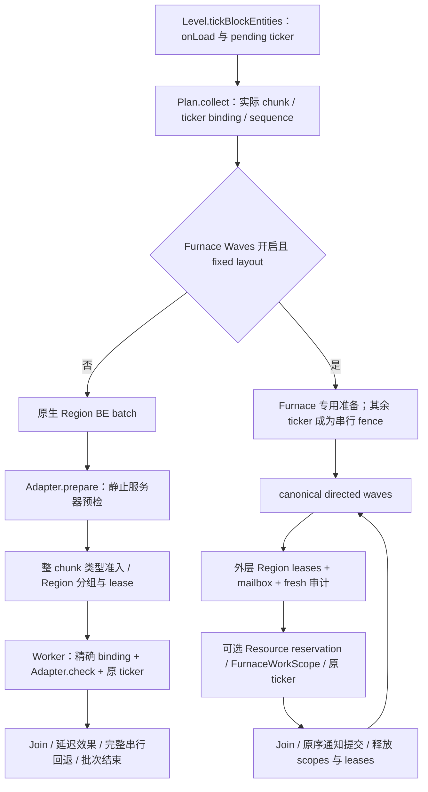

# Modded Block Entity 并行适配：第一轮架构调查与实施建议

调查基线：`4ea694316399b45ba60d07ade97b6d03babfde4f`（`.60-beta` 资源成本归因交付之后）。本轮只调查源码和设计契约，没有修改生产 Java、Vanilla patch、配置、适配器实现或 BE 准入，没有运行新的性能矩阵。Resource Ownership 的额外 MSPT 优化冻结；此前的分配下降和时延未通过结论保持，见[成本报告](BLOCK-ENTITY-RESOURCE-COST-ATTRIBUTION.md)。

所有下文标为“建议”的接口、状态、执行模式与诊断入口均未实现。现有 `BlockEntityTickAdapter`、`BlockEntityOperations` 和内部资源所有权协议分别按源码描述，不将规划能力写成现有功能。

## 调查结论与建议方向

Forgia 已具备 Region 调度、BE ticker 捕获、批次生命周期、原生 Mod BE 逐次准入、定向依赖规划和细粒度资源 Lease。缺少的是把这些机制组合起来的通用 **BE Execution Contract**，以及与 Mod 的完整 effects closure 相匹配的资源与效果协议。

建议以“核心负责执行和授权，独立适配器负责目标实现的语义审计”为边界。自动发现只建立候选清单；安全准入必须来自已审计适配器和本次调用的 fresh 证明。第一批通用 Mod BE 优先采用**一个 Region 同时只有一个执行 owner、不同 Region 并行的完整原 tick**。同 Region 细粒度并行、跨 Region 组件和拆分计算分别作为更强契约推进，不把所有 Mod 接入都绑定到 Furnace 的资源模式。

保留 Furnace Waves 作为受保护的参考实现。先建立可测试的契约和执行桥，再逐步封装其通用调度骨架；不通过扩大 Furnace exact-class 白名单、改一个类名或新增包名判断来接入模组。

## 1. 当前源码执行架构

### 1.1 收集入口与两条实际执行链

权威入口位于 [Level patch](../patches/net/minecraft/world/level/Level.java.patch#L274)。服务器线程先合并 pending ticker，执行 fresh BE 的 `onLoad()`，随后创建 `RegionBlockEntityTickPlan`。异常路径的 `finally` 仍恢复 ticking 标记、发布 pending ticker；不能把这些初始化和清理搬进通用 Worker。

[RegionBlockEntityTickPlan](../src/main/java/net/neoforged/neoforge/server/threading/region/RegionBlockEntityTickPlan.java#L92) 从实际持有 ticker 的 loaded chunk 收集工作，检查 block-ticking、实体加载状态和 tick-rate。缓存包括精确 wrapper/delegate binding、ticker revision、类型候选、interior 和 border policy；**不包括本次机器状态的成功证明**。foreign ticker 有独立路径，不能因缺少标准 bound ticker 而丢失原有串行调用。



分支入口在 [Engine.tickBlockEntities](../src/main/java/net/neoforged/neoforge/server/threading/region/RegionThreadingEngine.java#L5618)。这不是两套可以分别扫描并执行同一批 ticker 的独立插件：一个 level 的这次 BE phase 只选择其中一条路径。

### 1.2 现有模块及可复用程度

| 模块 | 当前职责与安全边界 | 对通用适配的意义 |
|---|---|---|
| [RegionScheduler](../src/main/java/net/neoforged/neoforge/server/threading/RegionScheduler.java#L12) / Engine / RegionState | 位置归属、任务队列、排他运行、worker pool、Region 生命周期 | 可复用调度设施；把任意 Runnable 放进 Region 队列不会自动证明其内部对象和回调安全 |
| [RegionBlockEntityTickAdmission](../src/main/java/net/neoforged/neoforge/server/threading/region/RegionBlockEntityTickAdmission.java#L27) / ChunkCache | 捕获原 ticker、delegate、位置和 sequence；缓存结构准入 | 可复用收集和原调用身份；必须与运行时语义准入分离 |
| [RegionBlockEntityTickBatch](../src/main/java/net/neoforged/neoforge/server/threading/region/RegionBlockEntityTickBatch.java#L47) | 按 Region 执行；未知类型导致整 chunk 回退；维护延迟效果和完整操作队列 | 粗粒度执行的基础，不能直接推导 canonical 全局顺序等价 |
| [BlockEntityTickAdapter](../src/main/java/net/neoforged/neoforge/server/threading/api/BlockEntityTickAdapter.java#L32) | `prepare(level)` + `check(instance)`；通过后运行完整原 ticker | 已有可用的审计接入点，但没有资源贡献、fresh refresh 结果、效果类型或多 owner 契约 |
| [ParallelAdapterRuntime](../src/main/java/net/neoforged/neoforge/server/threading/ParallelAdapterRuntime.java#L139) | server-scoped 注册冻结、重复类型拒绝、逐次检查及完成统计 | 应保留注册纪律与兼容机制；不能将 `ADMITTED` 当作一般资源证明 |
| [BlockEntityWorkPlanner](../src/main/java/net/neoforged/neoforge/server/threading/region/BlockEntityWorkPlanner.java#L16) | canonical READ/WRITE 定向依赖及 exclusive fence | 算法可复用；只规划，不授权；shadow footprint 不能用于准入 |
| [BlockEntityResourceOwnership](../src/main/java/net/neoforged/neoforge/server/threading/region/BlockEntityResourceOwnership.java#L28) | 当前资源 identity、whole-wave reservation、one-shot Lease / thread Scope | 可复用底层安全原语；minting 是内部协议，当前单 unit 只有一个 home，不是多 Region 事务系统 |
| [FurnaceWorkBatch](../src/main/java/net/neoforged/neoforge/server/threading/region/FurnaceWorkBatch.java#L9) / [RegionTickBatch](../src/main/java/net/neoforged/neoforge/server/threading/region/RegionTickBatch.java#L25) | 发布中的批次覆盖准备、worker、join、串行 fence 与提交 | external-wave 生命周期可作为通用 coordinator 的起点 |
| [BlockEntityOperations](../src/main/java/net/neoforged/neoforge/server/threading/api/BlockEntityOperations.java#L20) | 不透明两端引用；服务器静止阶段的完整操作；失效与至多执行一次 | 可用于明确允许异步完成语义的操作，不自动代替原 tick 中需要即时返回的搬运 |
| [Create 独立适配器](../adapters/create/src/main/java/net/neoforged/forgia/compat/create/CreateTickAdmission.java#L41) | 固定版本、exact class、整网预检、稳定路径逐次准入 | 已体现核心与模组隔离；仍基于旧粗粒度 admission 路径 |

### 1.3 Region、batch 和生命周期必须保持的顺序

[发布 batch](../src/main/java/net/neoforged/neoforge/server/threading/region/RegionThreadingEngine.java#L4585) 在 lifecycle read gate 下检查 level identity / shutdown 并登记 active batch；取得 Region lease 前释放这个 gate。`clearLevelRegionTasks` 和 shutdown 会持 write gate 等待已发布 batch，因此批次后续不能再次依赖取得同一个 lifecycle gate，否则可能死锁。

Region 必须从 authoritative regionizer 重新解析；lease 获取和 mailbox delivery 之后，才能把本次 fresh 证明转成执行权。`acquireRegionLease` 的等待会服务服务器 chunk-source barrier，不能因等候过久而直接放开还被 Worker 使用的世界。

[clearLevelRegionTasks](../src/main/java/net/neoforged/neoforge/server/threading/region/RegionThreadingEngine.java#L8413) 等待 active batches 与已提交任务后关闭 level identity、mailbox 和缓存；[shutdown](../src/main/java/net/neoforged/neoforge/server/threading/region/RegionThreadingEngine.java#L9952) 拒绝 Worker 自己进行生命周期等待，关闭新准入后 drain / join，再销毁 Region 和线程池。适配器注册服务同样不能跨 server session 存活。

保存边界也不能被误读：[beginLevelSave](../src/main/java/net/neoforged/neoforge/server/threading/region/RegionThreadingEngine.java#L8103) 会**诊断并记录**保存时仍有 active batch / 延迟效果的违规状态，它不是允许任意回调重入 save 的自动等待或事务保护。新契约仍须禁止机器在 Worker 或活跃提交期间发起重入 save/unload。

## 2. 与 Furnace 强绑定的部分

| 位置 | Furnace 专用假设 | 通用化时应怎样处理 |
|---|---|---|
| [FurnaceWorkPreparation](../src/main/java/net/neoforged/neoforge/server/threading/region/FurnaceWorkPreparation.java#L36) | 只认三种 exact Vanilla BE、三个 cooking recipe type、已点燃分支、普通 ItemStack、惰性通知闭包 | 保留为 Furnace adapter 的审计逻辑，禁止扩成“继承某基类就安全” |
| 同类 `pureCatalog` / `aliased` | cooking ingredients、OR children、mutable result/components、三槽库存的完整当前审计 | 通用 adapter 提交自己的完整资源闭包；核心负责统一 alias / dependency 校验 |
| [FurnaceResourcePreparation](../src/main/java/net/neoforged/neoforge/server/threading/region/FurnaceResourcePreparation.java#L21) | BE + chunk + 三个非空槽位 + RecipeManager publication；capture-time nonempty mask | 是特定资源模型，不可直接套给 `IItemHandler`、流体、能源或多方块结构 |
| [LevelChunk patch](../patches/net/minecraft/world/level/chunk/LevelChunk.java.patch#L539) | `furnaceWorkSource` 比较专门的 ticker 对象；`furnaceWorkMatchesChunk` 检查绑定的实际 chunk | 缺少等强度的通用 original ticker/source/chunk capture bridge；不能用位置和 type id 替代 |
| [FurnaceWorkScope](../src/main/java/net/neoforged/neoforge/server/threading/region/FurnaceWorkScope.java#L21) | `beforeBody`、三槽权限、只读 chunk、拒绝外部查询/副作用、`changed` 标记 | 核心应拥有通用 invocation permit；Furnace 的专用 hook 作为受保护实现继续存在 |
| [AbstractFurnaceBlockEntity patch](../patches/net/minecraft/world/level/block/entity/AbstractFurnaceBlockEntity.java.patch#L106) / [BlockEntity patch](../patches/net/minecraft/world/level/block/entity/BlockEntity.java.patch#L50) | 原方法入口/尾部 hook；截获指定 `setChanged`；join 后一次原序通知 | 不能假定所有 Mod 的多次 `setChanged`、override、event、packet 都可合并为一个 boolean |
| [Engine 的 wave/body/commit 方法](../src/main/java/net/neoforged/neoforge/server/threading/region/RegionThreadingEngine.java#L5753) | Candidate、Result、metrics、task label、scope、通知提交均为 Furnace 类型 | 应逐步抽出执行骨架，不让 Engine 新增 Create / 各模组分支 |
| [RegionThreadingHooks](../src/main/java/net/neoforged/neoforge/server/threading/RegionThreadingHooks.java#L1280) | 多处显式识别 FurnaceWorkScope 和 Resource Scope | 通用细粒度模式需要一致的所有权 hook，不能只在调度入口换 Runnable |

`.60` 描述复用和 scratch 仅是当前内部表示；本阶段直接复用已有正确性边界，停止继续调整其容量、扫描或微基准。

## 3. 当前接入阻碍

1. **两条执行链没有合流。** `tickBlockEntities` 提前进入 Furnace 分支，绕过旧 adapter 的 `prepare`；`FurnaceWorkPreparation.prepare` 明确拒绝 `ADAPTER_GUARDED`。开启 Furnace Waves 时，已注册 Create adapter 也不能凭旧接口进入这条细粒度链，相关原 ticker 保持串行。
2. **原生 adapter 只有布尔性质的调用许可。** `check` 在 Region owner 的 Worker 上运行，只能读本实例和静态/冻结 metadata；无法合法遍历外部网络来临时补资源，更不能中途申请另一个 Region。
3. **回退保证与全局顺序保证不同。** 旧路径在所有 Worker 后执行 fallback，并保持所收集 fallback 的顺序；它没有为任意 Mod 证明完整 canonical ticker 顺序。`A -> 未知 callback -> B` 不能简单改成先执行 A、B 再补 callback。新通用路径应使用完整 fence，执行 callback 后 fresh 准备 B。
4. **资源身份还缺 Mod 专用的 backing-resource 解析。** 两个不同 handler/wrapper 可指向同一库存；同一 root 可暴露侧面、合并、代理或跨区视图；不存在适用于所有 Capability 的自动拆包函数。
5. **当前 Claims 是单 home。** Builder 拒绝另一个 home 的本地 Binding，`home=null` 只允许显式共享 READ；整 phase 发现跨 home alias 或共享 READ 与 WRITE 别名会降为 fence。持有多个外层 Region lease 不会自动扩展一个 unit 的资源契约。
6. **整体 Region ownership 与细粒度 Scope 不能互换。** [RegionState.beginOwnership](../src/main/java/net/neoforged/neoforge/server/threading/region/RegionState.java#L471) 记录单个 `ownerThread`。Furnace 协调线程持 lease，多个细粒度 Worker 不会各自调用它来取得广泛世界写权限。未来混合模式必须显式冲突，不能在同一 Region 同时放粗粒度 owner 与细粒度 body。
7. **效果协议不通用。** 现有延迟 light/block updates、scheduled mutations、entity removals、border propagation、Furnace changed 提交服务于特定已审计路径。任意 Mod event、recipe、dirty callback、Capability listener 不能套用这些队列后就获得安全证明。
8. **旧完整操作 API 与执行上下文绑定。** `BlockEntityOperations` 的 Worker 来源通过 `currentBlockEntityOperationGroup` 和 `RegionBlockEntityTickScope` 验证；Furnace 细粒度路径没有这个普通 group 上下文。不能宣称新 adapter 自动能在所有执行模式下提交操作。它只接受同 level 的两端引用，也没有任意 N 方/跨维度网络事务。
9. **声明文件存在旧准入逃生口。** [RegionThreadingDeclarations](../src/main/java/net/neoforged/neoforge/server/threading/RegionThreadingDeclarations.java#L91) 实际支持 `admit_block_entities`，是 pack 作者的显式承诺，并非动态审计；文件顶部“只会收窄”的历史说明不能覆盖该后加路径。新框架不生成这类白名单、不把它等同于 adapter 合同；迁移时明确报告 legacy candidacy，不悄悄改变旧配置行为。
10. **运行时证据有边界。** exact class、原 jar hash 和已知 Mixin provenance 有用，但不能认证所有 ASM/coremod、反射写、外部异步线程或后加 listener。缓存同一 manager、handler 或 network id，不代表当前语义仍然相同。

## 4. 建议的核心与适配器边界

### 4.1 核心负责授权，adapter 贡献经过审计的事实

建议保持公开 API 层、内部 executor 层、目标 Mod 模块三层分离：

```text
公开 API / server-scoped registry
  descriptor + inspection/refresh + resource/effect requests + diagnostics
                       |
内部 BE coordinator / binding bridge
  lifecycle publication -> Region exclusion -> fresh proof -> directed plan
  -> scope/原 ticker -> join -> 有序提交 -> release
                       |
adapters/<mod>
  目标版本验证、exact types/classes、字段/behaviour/recipe/network 审计
  不依赖 Engine / RegionState / Lease minting，不自行提交线程池任务
```

公开 snapshot 只能携带深层不可变值和核心创建的不透明资源引用。运行时存储的 live BE/chunk/handler 可以由核心短生命周期内部记录持有，但不能以 public snapshot 或“快照安全”的名义交给任意 Worker。Java `record`、`List.copyOf` 和泛型都不能证明深层不可变。

### 4.2 建议公开接口形状

下面是待评审伪接口；类型名和签名尚未冻结，不可直接作为可编译 API 使用：

```java
interface BlockEntityExecutionAdapter<S> {
    AdapterDescriptor descriptor();

    // 静止的服务器线程；只读已加载、允许观察的状态；只产生候选，不能授予 Lease。
    Inspection<S> inspect(InspectionContext context);

    // 当前 wave 的外层排他与 mailbox 之后，重新形成本次资源/效果结果。
    Inspection<S> refresh(RefreshContext<S> context);
}

// 两类显式结果：
// Serial(reason)：尚未开始正文，由核心保留完整原 ticker。
// Candidate(immutableInput, resourceRequests, effectContract)：仍须核心验证和 reservation。
```

`AdapterDescriptor` 至少需要 adapter id、协议版本/能力、目标 mod 版本与受审计实现指纹、exact type/class/ticker 范围、支持的执行模式、效果契约和预算。重复 type 不能靠注册顺序决定赢家；显式 server-only、已知冲突和管理员开关仍具有否决权。沿用当前冻结注册、server session 清理和最多 128 个 adapter 的限制，新增规模限制须另有证据。

`inspect` 是规划输入，`refresh` 是本次调用重审；后者不能仅返回一个“版本未变”的 boolean。跨过任意串行 fence、mailbox delivery 或影响证明的生命周期变化后，必须形成新结果。涉及外部共享组件的审计只能在其完整允许读取范围静止时运行；拿着一个本地 Region lease 不能读取正被其他 Worker 修改的整张网络表。

`resourceRequests` 通过核心的 bound-instance / loaded-chunk handle 及已审计的目标资源解析器贡献资源。不能公开 `new Lease(...)`、任意 `home`、任意 `BooleanSupplier` 作为“强制通过验证”的入口。解析器本身属于 adapter 的可信审计面，核心检查 domain、实际归属、身份、当前 attachment 和预算；它不能自动证明一个 Mod 谎报的私有 backing storage 已完整列出。

第一版公开 adapter **不提供 `execute(Runnable)`、任意 `commit(Runnable)` 或替换原 tick 的捷径**。核心只执行已经捕获的完整 original ticker 一次，避免适配器遗漏继承、lazy tick 或插入回调。若将来需要纯计算拆分，另增明确的 compute/result/apply 契约，不把现有原生 ticker API 改造成可随意延期回调的接口。

### 4.3 分开表示执行模式

| 建议模式 | 执行权 | 首次开放范围 |
|---|---|---|
| `SERIAL` | 原始服务器调用；没有 Worker grant | 所有未知或拒绝单元的默认结果 |
| `NATIVE_REGION` | 一个 Worker 持完整 Region owner；运行完整原 tick | 首批通用 adapter；只放行整个 body 的本地状态和所有同步调用均已审计的路径 |
| `NATIVE_RESOURCES` | 协调线程保有外层 leases；Worker 只获完整细粒度资源 permit | 先只封装现有 Furnace 实现；其他 Mod 逐一证明，不因接口存在就开放 |
| 后续独立 `SNAPSHOT_COMPUTE` | Worker 只处理 detached 值；主线程验证并 apply | 重计算、弱世界访问机器；与完整原 tick 分开验收，必须证明拒绝时没有先行世界效果 |

粗粒度不会免除非本地共享资源审计；细粒度也不要求所有 Mod 都承担同 Region 并发的复杂度。`NATIVE_REGION` 可采用核心隐含的 Region 排他依赖；未来与 `NATIVE_RESOURCES` 混用时，所有细粒度单元必须参加相同的隐含 Region 冲突协议，例如 coarse WRITE / fine READ 的执行 token。这个 token 只控制排程，不授予世界读写权限。现有 Furnace Claims 没有这套通用混合模式协议，不能直接声称已支持。

### 4.4 内部执行契约与状态转换

核心内部应独占 invocation ticket 的创建、开始和结束。ticket 绑定 server session、level 实例、phase、canonical sequence、原 ticker/delegate、实际 source/chunk 和本次有效资源证明，不以坐标或 registry id 代替实例。

建议执行顺序：

1. 沿现有 Level 入口收集当前 ticker 与原序；初始化、加载 eligibility 和 pending 发布规则不变。
2. 以 lifecycle gate 发布 batch；level 关闭不再提交，shutdown 则遵循现有有效原调用处理规则。
3. 形成有界候选与未知 serial fence；初始资源输入用于规划，不用于获权。
4. 按 canonical lease order 解析并取得所需 Region 排他，交付 mailbox。
5. 对当前 wave fresh 审计 source/ticker/实际 chunk、attachment、资源与回调/通知条件；对整个 phase 做必要 alias 校验。
6. 资源与规划输入一致、预算完整、全部普通 validator occurrence 和 distinct shared proof 通过后，whole-wave reservation；任何拒绝都不能留下部分 grant。
7. 核心一次性开始 ticket；进入对应线程 Scope，执行原 ticker，记录正文开始、成功或失败。
8. 等待所有已提交工作真正结束；interruption / managed-wait 异常不能导致提前释放 lease。
9. 按证明过的 canonical 效果顺序提交；不允许后续 wave 越过尚未完成的通知或串行 fence。
10. 关闭 resource Scope/ownership、释放 Region lease，最后结束 published batch；所有异常出口都走清理。

准入失败发生在正文之前：整 wave 保留完整串行执行，或者由核心重新规划尚未开始的后缀。第一版宜直接保留该 wave 的 canonical 串行，减少恢复状态。旧 ticker 消失按原有语义跳过，失效 wrapper/替换实例不能继承旧 permit；仍有效的原调用走主线程路径。

正文或提交已经产生效果之后：失败就是失败，必须 join、清理和正常上报；不能运行完整原 tick 来“修复”。提交抛异常同样没有通用 rollback。Executor rejection / cancel 也必须区分未开始和已开始：只能处理已证明未开始的 ticket，不能与尚在运行的 Worker 并发重放。

## 5. 自动发现、资源审计和安全降级

### 5.1 自动发现的输出是候选目录

建议建立有界的 `BE type -> observed implementation -> matched adapter -> current refusal reason` 目录，来源包括：

- 已注册 `BlockEntityType` 的 id、所属 mod、版本和可用元数据；不为获取 Java class 或 ticker 而构造实例。
- 正常游戏过程中已加载、实际被收集到的 BE/ticker；在服务器静止点记录 exact class / 原绑定信息，不 force-load chunk。
- adapter manifest 对类型、实现和版本的匹配结果，以及明确的 server-only / legacy declaration 状态。
- 原 ticker 计数、抽样耗时和可选诊断 footprint；只用于选下一批审计对象。

禁止通过 `getCapability()`、反射遍历所有可达字段、`simulate=true` 或调用一次任意 handler 来“探测安全”。这些操作本身可能运行 Mod 代码。字节码调用扫描和实际 footprint 都只能提示风险，不能推出未来分支、反射、第三方 listener 或 unseen alias 不存在。

当前 `undeclaredTypes` 计数在 snapshot 重建时增加，**不是每 Tick 的回退数量或 CPU 热点**。新的诊断应区分 registry discovered、实际 observed、匹配成功、fresh refused、reserved、body started、native completed、serial completed 和 failed；同时记录准备/正文/提交成本。限制类型和 reason 标签数量，避免逐位置或网络 id 造成无界指标。

### 5.2 每个 adapter 的审计清单

每个受支持分支都应形成可评审的 effects ledger：

| 项目 | 必须回答的问题 |
|---|---|
| 完整调用闭包 | 原 ticker、父类、behaviour/lazy tick、Mixin、recipe、event listener、handler override 会执行哪些分支？ |
| mutable roots | 本机字段、库存列表、ItemStack/component、fluid/energy storage、共享 controller、network map、静态 cache 的真实身份是什么？ |
| alias / home | 不同 wrapper 是否同 root？同 root 是否被其他 BE、串行 ticker、player/menu、网络接口或异步线程持有？ |
| 分支条件 | 本 tick 是否初始化、完成配方、拓扑 dirty、周期验证、通知、掉落、RNG、发包或更新外部 manager？ |
| 生命周期 | 替换、ticker rebind、chunk unload/reload、component split/merge、reload/config 与 server stop 怎样使证明失效？ |
| effects / failure | 哪些效果允许 Worker，哪些只能服务器原序执行？是否需要同步返回值？部分效果后异常怎样终结？ |
| 预算 | 候选、资源 logical uses、组件成员、回调/通知队列是否有界？超限如何在 body 前回退？ |

复用现有 2048 units/phase、512 resources/unit、131072 logical uses/phase 的上限；复杂组件不能以隐藏成员或取消重复 validator 计数绕过预算。目标 Mod 如需额外 component budget，先独立设计和验证，不能偷偷提高核心限制。

### 5.3 降级规则

| 触发条件 | 处理 |
|---|---|
| 无 adapter / 不匹配版本、class、transform / 显式 server-only | 完整 serial fence；发现和统计不扩大准入 |
| 初始化、未知 behaviour、Capability/recipe/event/通知闭包未完成 | body 前拒绝，完整原 tick 串行 |
| 当前 source/ticker/chunk 或 resource attachment 变化 | 撤销候选，fresh 重建；无法维持原计划则整 wave 串行 |
| shared alias、home 不一致、跨区写无协议、预算溢出 | 不签发 Lease；组件相关单元保守拒绝 |
| 已开始的 body / commit 抛异常，或运行时越权 | join + 清理 + 正常 failure 报告；不重放，不把异常吞成“安全回退” |
| level/server 关闭 | 拒绝新 grant，等待 in-flight 完整结束，失效引用/队列进入明确终态 |

可设计 adapter 的单向隔离状态，用于停止后续 Worker 准入并保持完整串行；它不能把当前失败藏起来。恢复须重新满足版本、配置和 fresh 审计，不能靠“接下来几 Tick 没报错”自动重新放行。

## 6. NeoForge 与世界效果的安全边界

### 6.1 Capability

[BlockCapability.getCapability](../src/main/java/net/neoforged/neoforge/capabilities/BlockCapability.java#L204) 在调用线程读取 block/state/BE，并遍历 provider 直接调用。Provider 可能分配 wrapper、触发 lazy 初始化、转发远端、更新 cache 或进入模组回调。`isProxyable()` 仅说明可转发元数据，不是线程安全或所有权声明。

[BlockCapabilityCache](../src/main/java/net/neoforged/neoforge/capabilities/BlockCapabilityCache.java#L77) 有可变的 cachedCap / cacheValid / canQuery；失效直接运行 `isValid` 和 listener。[CapabilityListenerHolder](../src/main/java/net/neoforged/neoforge/capabilities/CapabilityListenerHolder.java#L30) 维护 level 级可变容器；[ServerLevel patch](../patches/net/minecraft/server/level/ServerLevel.java.patch#L740) 将 invalidate 调用同步转入这些容器。它们不提供通用并发访问契约，也没有自动调度到正确线程。

准入需要同时证明 provider、context/side、实际 backing resource、listener、invalidation 和消费者的完整调用。单纯持有一个 handler 引用或看到一次 cache invalidation 不够；该机制不跟踪所有库存内容或底层网络拓扑变化，且 level 整体卸载存在独立生命周期边界。第一批 adapter 不在 Worker 查询未知 Capability，也不在它上面注册/触发未知 listener。

### 6.2 Inventory、Fluid、Energy

[IItemHandler](../src/main/java/net/neoforged/neoforge/items/IItemHandler.java#L14) 是物品交互合同，不是锁、事务或不变快照。`getStackInSlot` 的结果要求调用者不修改；它也不因此变成 detached 数据。[ItemStackHandler](../src/main/java/net/neoforged/neoforge/items/ItemStackHandler.java#L19) 原地修改列表/stack，并调用可覆盖的 `isItemValid`、`getStackLimit`、`onContentsChanged` 等方法。

[InvWrapper](../src/main/java/net/neoforged/neoforge/items/wrapper/InvWrapper.java#L16) 转入 `Container` 的 canPlace/setItem/removeItem/setChanged；[CombinedInvWrapper](../src/main/java/net/neoforged/neoforge/items/wrapper/CombinedInvWrapper.java#L15) 只是多个 handler 的视图。不同 wrapper 的身份不是不同库存的证明；不要使用用户 `equals/hashCode` 划分 ownership。

`simulate=true` 只规定相应资源操作的模拟语义，不保证任意实现纯净、无 cache 或回调，也不保证随后实际执行状态相同。因此禁止把模拟调用用作无副作用的通用 preflight。Fluid/Energy 同理；[IEnergyStorage](../src/main/java/net/neoforged/neoforge/energy/IEnergyStorage.java#L16) 没有跨线程授权协议。

审计单位应是实际 mutable root、附属状态和 callback 闭包，而非 Capability id。ItemStack 数量、非空 membership、components、handler/list 被替换，以及 controller 多个侧面的共享都要覆盖。复杂未知 wrapper 无法解析 backing storage 时保持串行。

Vanilla 来源也不自动排除 Mod callback：[VanillaInventoryCodeHooks](../src/main/java/net/neoforged/neoforge/items/VanillaInventoryCodeHooks.java#L33) 的 Hopper/Dropper 操作会走 Capability handler。历史 Hopper 管线通过不能证明任意相邻 Mod 库存可在 Worker 使用。

### 6.3 邻居通知与有序提交

`setChanged` 可能同时标脏、比较器/邻居传播，以及通过 override 或 handler 再入触发模组效果。Furnace 的 `changed` 合并依赖它当前的受限方法和惰性通知闭包，不能泛化到任意 BE。

建议第一版只接受已明确审计的通知路径；需要未知邻居、event、packet、掉落或实体创建的完整 tick 保持串行。之后可增加核心识别的类型化 effects（例如特定协议的 dirty/同步记录），但必须定义提交点、顺序、合并规则、容量和异常语义，不提供万能 Runnable 队列。

若 callback 返回值、事件取消、即时邻居状态或同步 handler 结果决定后续原方法控制流，不能把 callback 随意挪到最后再继续算“完整原 tick”。要么保留整次串行，要么为该目标设计经过验证的显式 continuation。现有 border update/fixpoint 的捕获、重算和次 Tick 溢出处理，也不是任意 Mod 状态的串行等价证明。

### 6.4 Chunk、跨 Region 资源与复杂组件

[LevelChunk 的 ticker revision/rebind/unload](../patches/net/minecraft/world/level/chunk/LevelChunk.java.patch#L449)、[BlockEntity removal/invalidation](../patches/net/minecraft/world/level/block/entity/BlockEntity.java.patch#L61) 及 server session 都必须进入引用有效性。相同坐标、相同 chunk key、相同 network id 不可继承旧实例的权限；不为执行机器隐式加载新 chunk。

“全部位置 loaded”“机器位于 interior”“拿到了 network 对象的锁”都不足以允许跨 Region 写。第一批只支持单 home。跨区交互优先使用已有静止服务器完整操作，并明确这是异步结果、不是原方法的即时返回，也不是全局 canonical 排序协议；Worker 禁止等待它完成。

多方块/网络以后可设计有界的 `ComponentContract`：完整 loaded membership、所有 owner、实际资源和拓扑 revision，在 coordinator 上解析，canonical 获取全部 Region 排他，由单一组件执行者执行。**当前 Claims 不支持该多 home 模式**；实现前必须补足归属/失效/guard/生命周期和全部其他 writer 的协议，不能伪造一个公共 home。

组件也不能任意重排不连续 ticker：原序中间存在未知 callback 或其他依赖时，不能把整个网络的机器收拢到一个 batch 跨过 fence。拓扑组装、split/merge、成员缺失和全局注册表变更先保持串行。跨维度网络和 server-global mutable cache 首轮不开放。

### 6.5 Mod Callback、RNG 与快照

必须覆盖 event bus listener、recipe/ingredient、物品/流体回调、behaviour/lazy tick、attachments、容器 menu、同步包和外部写入者。主线程曾经安全执行某个函数，不代表持本地 Region lease 后就可以搬到 Worker。适配器的 `inspect/refresh` 本身也不能发事件、消耗游戏 RNG 或改变世界；异常按失败传播，不能当成普通 Serial 结果重试。

共享 `level.random` 或静态 RNG 属于有状态资源。现有 Region group RNG 有其确定性边界，源码明确不等同于 Vanilla 全局 RNG 流；首批目标优先选择不消耗共享 RNG 的路径。以后若要开放随机产物，必须单独说明算法、顺序与串行对照，不能仅以输出分布相近代替状态等价。

Snapshot-compute 的 Worker 只读 detached 值，commit 前验证全部输入依赖。只有纯计算尚未产生世界/RNG/event 效果时，结果作废后才可保留完整串行原调用；不能将带 live ItemStack/component 的浅拷贝叫作纯快照。

## 7. Create 的独立适配方案

现有 `adapters/create` 已是合适的模块边界：核心不 import Create，适配模块独立编译/打包，使用公开 API 和自己维护的只读 accessor，不 shade 核心 API 或上游实现。缺目标 jar 时构建明确跳过，不发布空适配器。可选依赖隔离、版本指纹和转换审计应保留。

本轮核对了本地 Create 6.0.10 原 jar，SHA-256 为 `ef87fe5709f1ba1f5b8bb20a2925b5afb4669e178fd6d8bf10c167759eefe37a`；`KineticNetwork`、`SmartBlockEntity`、`KineticBlockEntity`、`MillstoneBlockEntity` 四个原 class 均与 [CreateAudit](../adapters/create/src/main/java/net/neoforged/forgia/compat/create/CreateAudit.java#L36) 的既有指纹匹配。阅读本地既有反编译材料用于语义调查，没有复制上游实现到交付文件，也没有将原 class hash 当作所有运行时变换的认证。

实际闭包解释了为何不能按 Create namespace 统一放行：

- `SmartBlockEntity.tick` 包含初始化、lazy tick 和 behaviour tick；初始化会发布 behaviour event。未知 behaviour 或到期 lazy 分支可能增加完全不同的效果。
- `KineticBlockEntity.tick` 可调用 attach/validate/updateNetwork；`KineticNetwork` 的 members/sources 为共享可变 map，更新容量/压力会遍历成员并回调 `updateFromNetwork`，继而 dirty/同步其他 BE。
- Millstone 的稳定倒计时与配方完成不同。完成路径会查询配方、消耗原料、roll 随机产物、写库存、奖励、同步和通知；其 Capability wrapper 的 `isItemValid` / insert 也能进入 recipe 查询，模拟调用不能当作纯探测。

建议分成三个独立契约：

| Create 契约 | 方向 | 初始限制 |
|---|---|---|
| 稳定本机 tick | 继续已有传动、水车惰性周期、Millstone 未完成倒计时；迁移到新 registry/inspection 桥 | whole-network audit + exact class/behaviour + 本次状态重审；任何拓扑/处理回调保持完整串行 |
| 拓扑与共享动力组件 | 后续 ComponentContract，按完整依赖闭包处理网络更新 | unknown/add-on member、unloaded member、split/merge、跨区未证明状态均拒绝；先串行拓扑 |
| 加工和物流 | 每种机器/handler/recipe 单独审计；可评估纯计算与有序服务器效果 | 不从“磨石倒计时支持”推导完成加工、传送带、漏斗、流体网、多方块和 contraption 已安全 |

已有 `Prepared(dimension, gameTime, stableNetworks)` 是旧路径一次 quiescent prepare 后的局部契约。迁移到有任意串行 fence 的通用执行链时，仅凭同 Tick/network id 不够；必须在可能改变网络的 fence 之后重新审计组件。不能机械复制这份集合并跨 wave 继续当成功证明。

复杂目标的字段访问、原实现指纹、Mixin accessor、测试和诊断都留在 `adapters/create`；核心只理解执行模式、资源/组件、效果契约、拒绝原因和生命周期。不把 `if (modId == "create")`、`KineticNetwork` 或 Create recipe 类型放进核心调度器。

## 8. 风险分级与控制

| 风险 | 级别 | 必要控制 |
|---|---|---|
| 把未知 provider/handler/event 移到 Worker | P0 | 未知闭包整次串行；不以接口、包名或观察样本授予许可 |
| 两条 BE 执行链重复扫描/重复 tick | P0 | 一个 invocation ticket / 一条执行路径；组合开关测试和每 Tick exactly-once 断言 |
| 粗粒度 owner 与同 Region fine body 重叠 | P0 | 隐含 Region 冲突协议；不同 Scope 权限明确隔离 |
| fence 之后复用旧网络/库存/recipe 证明 | P0 | fresh refresh、actual attachment 和 phase/instance 绑定；未知 fence 不能跨过 |
| wrapper alias / 多 home 伪装 / 外部 async writer | P0 | backing root 审计；无法证明独占则串行；多 home 另立协议 |
| body 或 commit 已部分生效后重试 | P0 | Started 不可回退；异常上报、join/cleanup；不提供通用 rollback |
| 卸载/替换/停机早于 Worker 或提交结束 | P0 | active batch、精确绑定、canonical leases、无提前释放和自等待 |
| 通知、RNG、callback 顺序变化但最终物品数相同 | P1 | 完整状态和 trace 对照，明确 ordered effects；首批不开放未知即时回调/RNG |
| 类型白名单/动态统计被误当资源审计 | P1 | discovery、legacy declarations、fresh admission 分开报告 |
| 诊断/prepare 无界、拒绝过多导致性能回退 | P1 | bounded collection、有限队列、拒绝/耗时归因；先降低目标复杂度，不删除安全检查 |
| 旧 API 兼容和可选 Mod 类加载失败 | P1 | 新能力协商/新注册入口；v1 保留；API jar 不含 Engine 或目标 Mod 类 |

Lease/Scope 是参与式安全协议，不是 JVM sandbox。若存在未参与协议的任意字段写入或异步 Mod，仅凭调度器无法给予安全保证；第一轮方案明确拒绝将这类运行环境自动认证。

## 9. 渐进实施路线与验收门槛

各阶段按退出条件推进，不用日期或一个“支持所有 Mod”的比例代替完成标准。冻结 Resource Ownership 的额外 MSPT 调参不妨碍复用现有安全原语，也不把新适配阶段变成新的微基准循环。

| 阶段 | 最小交付 | 进入下一阶段的条件 |
|---|---|---|
| P0：本轮调查与契约评审 | 本报告、当前/建议能力边界、单 home 起步和兼容策略 | 决定首个目标 BE 的真实实现范围、执行模式和 effects ledger；本轮不做生产修改 |
| P1：发现与契约模型 | 有界 registry/loaded-ticker 目录；descriptor、Serial/Candidate/refresh 和内部 ticket 状态测试；只诊断 | discovery 不改路由、不调用未知 provider、不 force-load、不产生权限；拒绝、shutdown 和注册兼容明确 |
| P2：封装共用执行骨架 | 把生命周期、canonical waves、leases、join/cleanup 与目标审计分开；先以现有 Furnace 为内部参考 | 旧开关默认路径保持；Furnace 固定/persistent、resources OFF/ON、异常不重放、通知和动态/管线状态完整等价 |
| P3：首个简单 Mod BE | 独立模块适配一种 exact implementation；单 home、Region 粗粒度、完整原 tick | 先用可控 fixture，再用真实原 Mod jar；无共享 RNG/未知 Capability/拓扑/主动通知；至少两个 Region 实际重叠且状态/trace 等价 |
| P4：本机库存/能源与明确效果 | 为已知 backing storage 和 handler override 建立独立资源解析；必要时使用完整服务器操作 | alias、多侧 wrapper、components/非空变化、replacement、listener、拒绝/异常全部覆盖；即时结果需求无法满足就保留整次串行 |
| P5：Create 稳定路径迁移及可选细粒度 | 迁移现有独立 Create adapter；fine 模式仍逐目标开放；可另试纯计算拆分 | 两条执行模式混用与 Furnace 共存经过验证；包含实际变换 Create、未知 behaviour/Mixin 和 fence 后拓扑变化的负面对照 |
| P6：多方块与跨 Region 组件 | 单 Region controller 起步，再考虑有界多 owner ComponentContract | loaded membership/归属/alias/拓扑变更完整证明；不跨未知 fence 重排；跨维度、移动结构和未知物流网络继续单独拒绝 |

P3 的“简单”按完整调用闭包定义，不按 Mod 名称或代码行数定义。适合作为第一例的是只更新自身状态/自有存储、无共享网络、无未知 listener，且 dirty/通知仅走已审计闭包的机器；第一例可限制在惰性邻居环境。不能为了获得第一个 Worker 计数而删掉原机器的同步、消耗、配方完成或通知。

跨 Region 独立机器并行足以验证第一版框架；同 Region fine-grained 不是第一批必须完成的指标。Snapshot-compute 是独立可选路线，计算量足够大且输入能可靠 detach 时再评估，不强制拆所有机器原 tick。

### 9.1 与现有开关和 API 的迁移规则

- 新 generic 功能未启用或仅 discovery 时，完全保留当前两条执行链的选择和行为。Resource Ownership 默认仍关闭，现有开关不被 adapter 自动开启。
- generic 粗粒度模式不以开启资源细粒度开关为前提；它有自己的候选/审计/执行条件。
- 新 generic 模式与 Furnace Waves 的组合在统一 ticket/排序桥验证之前，应**拒绝新的 generic Worker 准入，保留已有 Furnace 路径**；不能静默关闭 Furnace 或让两个 executor 各 tick 一遍。
- P2 后采用经验证的单一 coordinator 衔接 Furnace 专用 body/scope 与 generic contract；不能仅把旧 `BlockEntityTickAdapter.check` 包装成“完整资源证明”。v1 adapter 保持其粗粒度语义及 interior/whole-chunk 限制，迁移显式进行。
- 新能力名、注册函数和 API major/minor 协商在 P1 决定；不修改旧抽象接口的必实现方法造成既有 Create binary 失效。公开 API 工件仍只包含 facade，不包含内部授权实现。

### 9.2 正确性与有限性能验收

复用现有 Furnace、Resource Ownership、Adapter、Chunk/Lifecycle 和 installed-server 工具作为基线，但新增 Mod 需要自己的真实状态 oracle。已有测试通过不是新增能力通过，本轮未重跑 JUnit、Create、GameTest 或服务器矩阵。

下一轮实现至少覆盖：

1. **语义状态与 trace**：相同初始世界下串行/并行对照完整库存/components、energy/fluid、进度/配方、拓扑/controller、dirty/通知/callback 顺序、RNG 契约、保存/重载和输出守恒；不能只比较 Tick 数或最终物品数量。
2. **顺序**：已适配 A、未知回调 U、已适配 B 的 canonical fence；`A(X), B(X,Y), C(Y)` 的定向依赖；不同适配器争用同资源和 coarse/fine 混合；必要效果在后续 wave 开始前提交。
3. **fresh 与失效**：同位置 BE 替换、ticker rebind、实际 chunk 替换、inventory wrapper/root/side 变化、同引用空 stack 变非空、组件原地修改、recipe/config reload、unknown behaviour/Mixin、拓扑变化和缺成员。
4. **生命周期与失败**：加载/实体 eligibility、queued/unstarted rejection、部分效果后异常、commit 异常、join 被打断、budget 溢出、save/unload/stop 竞争和旧 service/ref 失效；所有 scope/lease/permit 无泄漏且不重放。
5. **真实执行**：独立 JVM、真实变换后的目标 Mod + adapter，确认原 body 实际在正确线程运行、受审计的两个 Region 可重叠、未知分支仍完整串行；fixture 测试不能代替真实安装服。
6. **有限性能检查**：在正确性通过后做针对适配目标的反序 OFF/ON；保留完整 MSPT、P95/P99、allocation、GC、prepare/refresh/commit 成本和全部慢窗。重点确认适配路径的可用性和无未解释回退，不继续围绕现有 Furnace 微基准无期限调参。

## 10. 下一轮建议决策

建议先确定 P1/P2 的 contract 与执行桥范围，保留 v1 API，然后选一个真实实现可完整审计的单 home 简单 Mod BE，采用 `NATIVE_REGION` 完整原 tick 路线。Create 稳定路径作为第二个独立模块用例，用于验证网络预检、动态 refusal 和核心隔离，而不是第一步就开放拓扑更新或完整加工链。

本轮没有足够证据选出可无条件放行的未知 Mod 类型，也不建议立刻实现多 home 所有权、通用 Capability 并发或任意 callback continuation。后续具体生产代码改动以本调查后的目标和接口决策为准。
